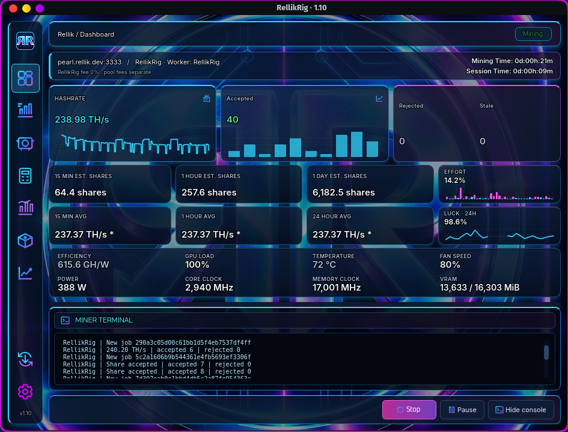
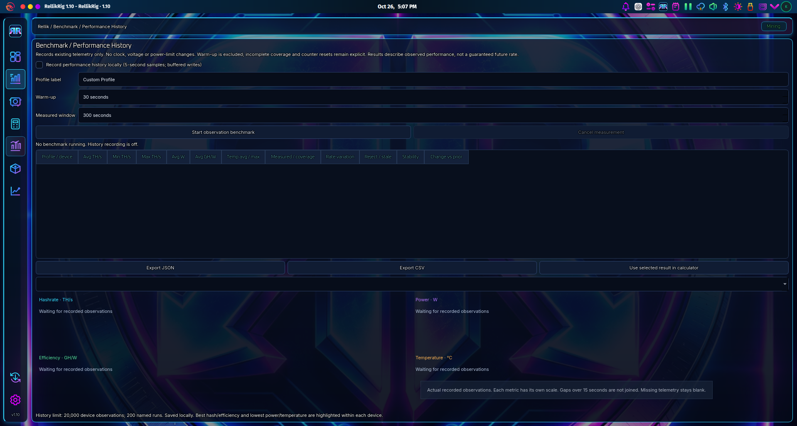
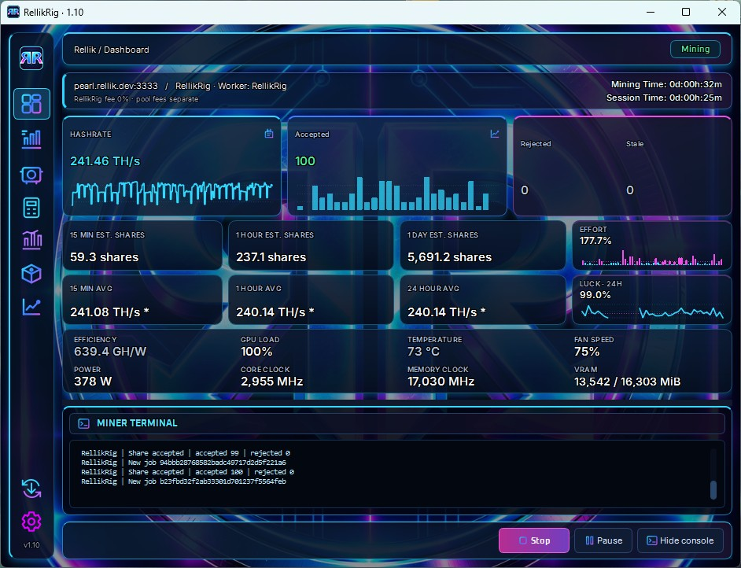
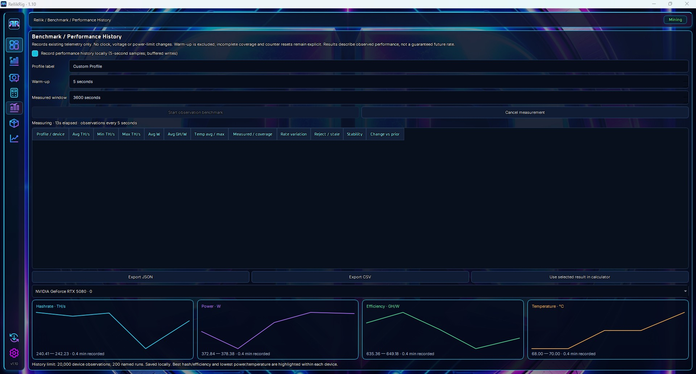
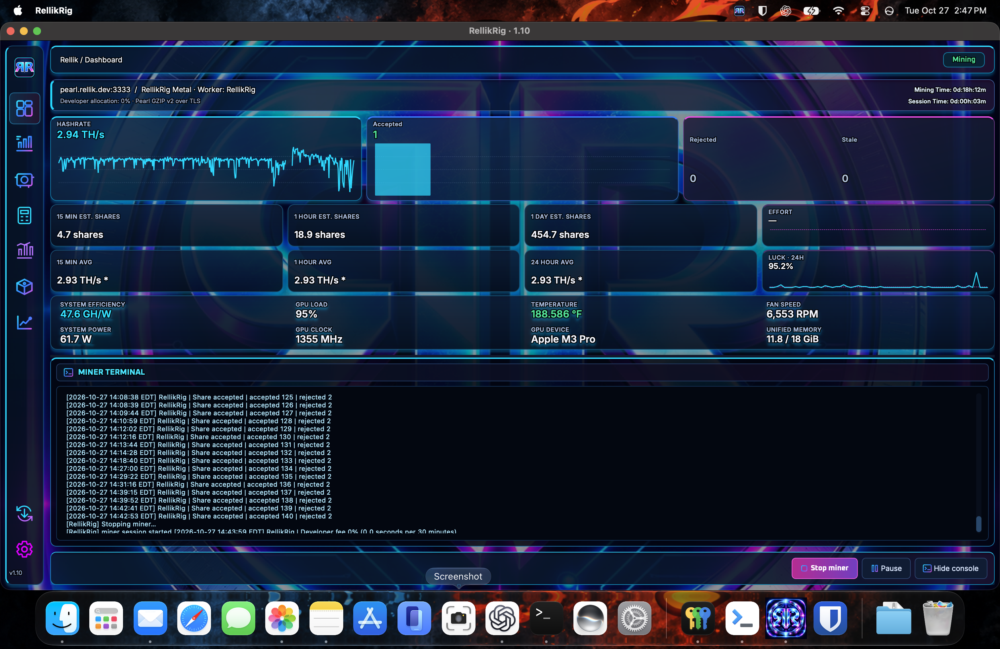
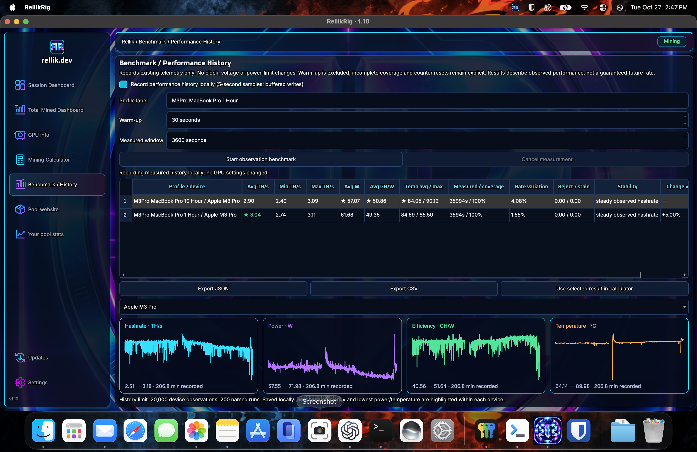

# RellikRig 1.10

Pearl GPU mining for **Windows, Linux, and Apple silicon Mac**, with a native mining engine, live dashboard, profitability calculator, and measured benchmark history. This is the **full 1.10 release**, without a Beta or RC label.

[Download 1.10](https://github.com/RellikRig/RellikRig-Pearl/releases/tag/v1.10) · [All platform screenshots and exports](docs/v1.10/README.md) · [Support](SUPPORT.md) · [License](LICENSE.txt)

## Download and first run

| Platform | Package | Open after extracting |
|---|---|---|
| Windows x64 / NVIDIA | [RellikRig-Windows-1.10.zip](https://github.com/RellikRig/RellikRig-Pearl/releases/download/v1.10/RellikRig-Windows-1.10.zip) | `RellikRig.exe` |
| Linux x64 / NVIDIA | [RellikRig-Linux-1.10.zip](https://github.com/RellikRig/RellikRig-Pearl/releases/download/v1.10/RellikRig-Linux-1.10.zip) | `./RellikRig` |
| macOS / Apple silicon arm64 | [RellikRig-Mac-1.10.zip](https://github.com/RellikRig/RellikRig-Pearl/releases/download/v1.10/RellikRig-Mac-1.10.zip) | `RellikRig.app` |

Download [SHA256SUMS.txt](https://github.com/RellikRig/RellikRig-Pearl/releases/download/v1.10/SHA256SUMS.txt) to verify the archives. Extract the **entire** archive; keep all included files and folders beside the Windows/Linux executable. Python, Rust, Xcode, and the CUDA Toolkit are not required to run the packages. Windows/Linux require an appropriate NVIDIA driver. Mac requires Apple silicon; the published owner measurements are from an M3 Pro with 18 GB unified memory. The Mac app is locally signed and is not Apple Developer ID notarized.

1. Open **Settings**, select the engine on Windows/Linux, and review the wallet, worker, pool, and device selection.
2. **Replace the prefilled publisher PRL address with your own receiving address before mining for yourself.** The prefilled address is intentional; it is not generated for the person downloading the app.
3. The default pool is `stratum+ssl://pearl.rellik.dev:3333`. Leave share difficulty blank for automatic pool difficulty, or set a compatible custom value.
4. Save settings and choose **Start miner**. New installations start mining only after you press Start; existing saved startup preferences are retained.

Changes to engine, wallet, pool, devices, and API port apply on the next Stop → Start. Stop another independently running GPU miner first. RellikRig does not terminate unrelated mining applications.

## What is new in 1.10

- Completely redesigned cyan, blue, and magenta interface using the new RR artwork, icons, translucent cards, clear outlines, and floating shadows.
- Click the centered **RR icon** to expand or collapse sidebar labels. Expanded icons align left; the layout choice is saved. Settings stays at the bottom, with Updates above it.
- Separate **Session Dashboard** and **Total Mined Dashboard** sidebar entries; Session is the default. GPU info is a sidebar page; mining and API settings are one scrollable list.
- Live hashrate line inside the hashrate card; accepted-share bars use **one-minute intervals**. The former large history chart and last-block-found card have been removed from the dashboard.
- Completed-share effort bars, a faster one-minute luck line, and pink dotted 100% references. Effort and luck appear only in Session. Estimated-share cards share a row, with rolling averages below them.
- Console open by default, with clean spacing under the GPU summary. Hiding it collapses the unused window space. Console is output-only: no command text field, Send command, or Send key controls.
- Optional **Celsius/Fahrenheit** display. Temperature turns orange at the elevated threshold and red 3°C before the configured critical threshold. Defaults: orange at 75°C / 167°F, red at 82°C / 179.6°F, critical at 85°C / 185°F. Threshold settings stay in Celsius. These colors are display indications, not GPU thermal controls.
- Readable tooltip text without outlines, wrapping at approximately 300 px and constrained to the window where possible or the screen otherwise. Text outlines improve dashboard readability; operation buttons retain normal text.
- **Mining Calculator** with live telemetry, current pool/network/price inputs, editable assumptions, and saved scenarios. Electricity defaults to $0/kWh.
- **Benchmark / History** with named observation runs, warm-up exclusion, measured coverage, device comparisons, CSV/JSON export, and **four separately bordered graph cards in one horizontal row**.
- **Updates** button checks GitHub, downloads the platform ZIP, and verifies its SHA-256. Installation is manual after stopping and exiting; the app does not replace running mining files.
- Fixed Mac startup when no miner statistics exist, temperature parsing from NVIDIA driver text readings, and unstable pool/worker header updates.

## Mining engines, pools, and fees

| Engine | Supported platforms | RellikRig fee |
|---|---|---|
| Native RellikRig NVIDIA engine | Windows, Linux | 0% on `pearl.rellik.dev`; 2% on other compatible pools |
| Native RellikRig Metal engine | Apple silicon Mac | 0% on `pearl.rellik.dev`; 2% on other compatible pools |
| Optional PeakMiner runner / monitor | Windows, Linux | Additional 1% RellikRig controller fee, plus PeakMiner's own developer fee |

Pool fees are separate. The app shows the applicable fee for the selected engine and pool. Native packaged mining/proof/fee behavior is retained in this GUI release. Engine telemetry and benchmark exports may still identify the retained native engine as **1.07 RC**; the application release and download version is **1.10**.

**PeakMiner is not bundled.** Download it separately from its [official releases](https://github.com/peakminer/peakminer/releases), place it in the empty `Peakminer` directory, then select PeakMiner in Settings. Browse selects another location; Open folder opens the directory. The executable can also be detected inside an extracted subfolder. On Linux, give the downloaded executable permission to run. Use one selected miner at a time. BZMiner/SRBMiner are not advertised as supported in this release.

The default connection uses verified TLS. Alternative pools must support the packaged Pearl proof protocol; a pool connection alone does not guarantee compatible share submission. The optional local relay address, connection/latency fallback, and custom difficulty controls are retained on Windows/Linux.

Windows/Linux include device selection (`all`, one index, or comma-separated indices), combined dashboard statistics, and per-GPU rows. Packaged architecture support does not imply that every card or VRAM capacity has been hardware-qualified. The retained RTX 5080 profile uses about 14 GB available VRAM; the supplied measurements validate the RTX 5080, not a 12 GB 4070 Ti. No new 4070 Ti performance claim is made here. Mac uses its native Metal/Accelerate backend, not PeakMiner or CUDA.

## Dashboard, charts, and counters

- **Hashrate:** current measured rate in Session; accumulated measured active-work average in Total. The embedded trace refreshes with telemetry, rather than 15-minute buckets.
- **Accepted, rejected, and stale:** observed local counters for the selected view. Rejection reasons distinguish stale from other pool rejects; unknown older reasons are not invented. Local stale drops are separate from pool stale responses.
- **Mining Time / Session Time:** cumulative observed active mining time and the current observed session. Stopped, paused, disconnected, or unavailable work does not fabricate active time. Totals persist across restarts; Reset accumulated totals is available in Settings with confirmation.
- **15-minute, 1-hour, and 24-hour averages:** rolling, time-weighted observed rates in Session. An asterisk denotes partial history. Missing telemetry and time while the app is closed are not reconstructed.
- **Estimated shares:** projections for 15 minutes, one hour, and one day from accepted count divided by observed active mining time. These are estimates, not promised future shares or pool balances.
- **Effort:** one bar per individually observed completed accepted share: active seconds taken ÷ expected interval × 100%. The expected interval comes from the selected observed share rate; 35 expected shares per 15 minutes means 900 ÷ 35 = 25.71 seconds for 100% effort. Lower is faster; higher took longer. First shares and multi-share polling batches are omitted when individual durations are unknown.
- **Luck:** accepted ÷ expected shares × 100%, using observed hashrate and pool target history. The label is a 24-hour aggregate; the line shows one-minute intervals over the recent hour. Above 100% means more shares than expected in that observation window. This is not a probability of the next share.
- **GPU summary:** efficiency, load, temperature, fan, power, clocks, and memory where available. Windows/Linux readings are GPU values; multiple-device totals/maximums/averages are identified in GPU info. Mac reports whole-system power, unified memory, and platform-available Apple telemetry; unavailable sensors remain blank.

Saved local history is bounded and periodically persisted. Sudden power loss can lose the latest unsaved observations. Counters include locally observed allocation work and are not authoritative pool payout accounting.

## Start, stop, pause, idle, and tray

Start/Stop and Pause/Resume remain available from the dashboard and tray. Manual pause frees the mining GPU; resume reconnects with the session settings. Optional timed resume and idle-only mining respect the selected idle delay. Stop cancels automatic resumes. Idle detection observes whether input occurred, not typed content; unavailable idle detection is reported rather than assumed idle.

Windows/Linux idle controls use the platform's input timing or supported X11/Wayland idle backend. Mac includes pause-while-in-use, idle delay, keep-awake, battery-warning behavior, and optional menu-bar operation. Window-close behavior, login startup, and mining-on-launch are configurable. Exit stops app-owned mining. An older application restored by the desktop session manager should be removed from that saved session separately from the current autostart entry.

The embedded terminal shows live miner output. Pool website and Your pool stats open the system browser; the latter copies the configured wallet for lookup. Browser/file-manager launching, diagnostics ZIP creation, saved settings, GPU monitoring while stopped, and local summary links remain available.

## Profitability calculator

Use live measured telemetry, a saved benchmark profile, or manual inputs. The calculator preloads available hashrate/power, pool fee, network hashrate/difficulty, current block reward, measured block interval, and PRL/USD price from the compatible public data feed; source timestamps and missing values stay visible. It supports per-device or combined scenarios, electricity price, mining hours/day, optional hardware cost/ROI, fee overrides, manual network/price assumptions, and refresh/save controls.

Results cover 1, 7, and 30 days, expected PRL, gross revenue, electricity cost, net revenue, and applicable fee effects. PPLNS outputs are long-run expectations, **not earned balance or guaranteed payouts**. Device/system power scope matters. An unknown input is shown as unavailable rather than guessed. Saved overrides take precedence until cleared. The calculator does not change hardware settings or place trades.

## Benchmarks and performance history

Benchmarking records the miner that is already running; it does not overclock the GPU or launch an unrelated miner. Choose a label, warm-up, and measured window. Local history recording is optional. Results include average/min/max hashrate, power, efficiency, temperature, sample coverage, gaps, counter resets, rate variation, rejected/stale observations, and an observed stability description. Named runs can be compared per device, exported as CSV/JSON, and selected in the calculator. Four cards chart hashrate, power, efficiency, and temperature with independent scales and explicit gaps.

### Owner-supplied measured results

| Platform / hardware | Measured window | Coverage | Avg TH/s | Avg W | Avg GH/W | Avg / max °C | Accepted | Rejected / stale* |
|---|---:|---:|---:|---:|---:|---:|---:|---:|
| Linux · RTX 5080 | 10 hours | 99.98% | 241.343 | 384.971 | 626.940 | 69.48 / 74.00 | 2,546 | 3 / 3 |
| Windows · RTX 5080 | 1 hour | 99.92% | 240.946 | 377.833 | 637.850 | 72.62 / 74.00 | 248 | 1 / 1 |
| Mac · Apple M3 Pro | 10 hours | 99.98% | 2.899 | 57.072 | 50.863 | 84.05 / 90.19 | 346 | 0 / 0 |
| Mac · Apple M3 Pro | 1 hour | 99.83% | 3.044 | 61.680 | 49.353 | 84.69 / 85.50 | 34 | 0 / 0 |

These are time-weighted values from the supplied exports, not advertised minimums. Windows/Linux use **GPU power**; Mac uses **whole-Mac power**, so efficiencies are not directly comparable. Run durations, tuning labels, sampling, and temperatures differ. Tuning labels are the owner's recorded conditions, not recommended settings. *Rejected/stale columns reproduce the export fields; they can overlap and must not be added together. No pool-side proof-validity audit is implied by these counts. A 150-second Linux run is also included in the raw exports.

[Linux JSON](docs/v1.10/linux-benchmarks.json) · [Linux CSV](docs/v1.10/linux-benchmarks.csv) · [Windows JSON](docs/v1.10/windows-benchmarks.json) · [Windows CSV](docs/v1.10/windows-benchmarks.csv) · [Mac JSON](docs/v1.10/mac-benchmarks.json) · [Mac CSV](docs/v1.10/mac-benchmarks.csv)

## Screenshots

Owner-provided platform captures; some show the retained engine version or pre-final tooltip/temperature formatting.

### Linux

### Windows

### Mac

[Full gallery: session/total dashboards, expanded navigation, GPU info, settings, calculator, updates, and benchmark screens](docs/v1.10/README.md)

## API, privacy, and troubleshooting

One local API port is shared by the selected engine on Windows/Linux, default `4067`; only one should be active. The running session's summary link keeps its active port until Stop → Start. Mac exposes its local native summary at `http://127.0.0.1:4067/summary`. Loopback APIs are local and do not open router/firewall ports.

Mining traffic goes to the configured pool. Calculator refreshes contact the compatible public pool/network/price feed; update checks/downloads contact GitHub; external links open your browser. Local history/benchmarks are opt-in; there is no separate analytics upload. The default wallet is public and editable. Diagnostic exports redact wallet information; review any diagnostic before sharing it.

If the app cannot launch, extract the whole package again and check OS/architecture. For missing NVIDIA telemetry, test `nvidia-smi`. For occupied API ports, stop another instance or select a free port. For rejected shares, report the selected engine, pool protocol, version, and exact rejection reason; connected does not necessarily mean compatible. Do not run old and new releases together. Updates require stopping/exiting and manually installing the verified download.

Submit issues with OS, driver, device, selected engine, and error text at [GitHub Issues](https://github.com/RellikRig/RellikRig-Pearl/issues). See [SUPPORT.md](SUPPORT.md) and [SECURITY.md](SECURITY.md).

## License and source availability

RellikRig implementation source remains private. Application and controller modules are compiled to native machine code, rather than distributed as packaged Python bytecode. Native compilation makes recovery harder; it does not make reverse engineering impossible. This repository distributes public documentation, owner-provided screenshots/benchmark exports, notices, and compiled release packages only. GitHub's automatic “Source code” ZIP/TAR assets contain this **documentation repository**, not the miner implementation.

See [LICENSE.txt](LICENSE.txt), [THIRD_PARTY.md](THIRD_PARTY.md), and bundled component notices. Qt/PySide LGPL rights and third-party licenses remain applicable. PeakMiner is separately downloaded and governed by its own license/fees.
