# RellikRig v1.22

## Follow Rellik.Dev

- [X / Twitter — @rellikdev](https://x.com/rellikdev?s=11)
- [TikTok — @rellik.dev](https://www.tiktok.com/@rellik.dev)
- [Reddit — u/RellikDev](https://www.reddit.com/u/RellikDev/s/hwEroVqcew)

## Current release: v1.22 (Windows/Linux)

RellikRig v1.22 is the current public Windows and Linux release. It retains the configurable primary/backup pool failover introduced in v1.21 and adds **Pearl block receipt history and system-tray notices**.

With a backup pool configured, RellikRig retries the primary pool and switches to the backup after three failed primary attempts. It can return to the primary after it is healthy again. The RellikRig development fee is **0% on the native Rellik pool** and **2% on an external backup pool**; pool fees are separate.

**Download:** [Windows installer](https://github.com/RellikRig/RellikRig-Pearl/releases/download/v1.22/Install-RellikRig-Windows-1.22.zip) · [Windows portable ZIP](https://github.com/RellikRig/RellikRig-Pearl/releases/download/v1.22/RellikRig-Windows-1.22.zip) · [Linux ZIP](https://github.com/RellikRig/RellikRig-Pearl/releases/download/v1.22/RellikRig-Linux-1.22.zip) · [SHA-256 checksums](https://github.com/RellikRig/RellikRig-Pearl/releases/download/v1.22/RELEASE-SHA256SUMS.txt) · [Full v1.22 release notes](https://github.com/RellikRig/RellikRig-Pearl/releases/tag/v1.22)

The new block notices cover observed **Pearl pool receipts**, not guaranteed payouts or block-finder attribution. **NOCK canonical block-found alerts are unavailable.** macOS remains on its separate v1.10 build; v1.22 is not a Mac release. The Windows GUI/controller passed Wine checks, but native Windows GPU operation for this build still needs hardware validation.

## Earlier v1.2 Linux demo

[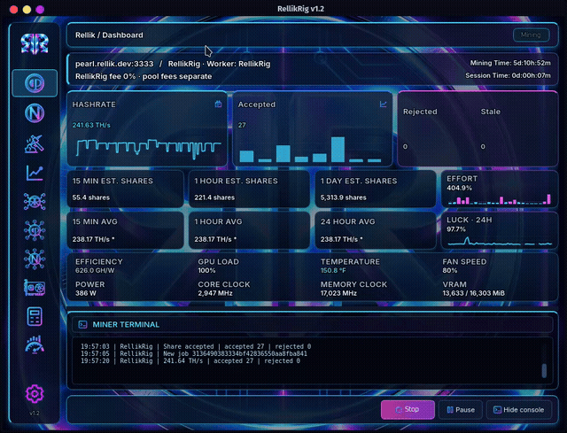](https://github.com/RellikRig/RellikRig-Pearl/raw/refs/heads/main/docs/v1.2/RellikRig-Demo-v12.mp4)

**[Watch or download the full Linux demo (76 seconds)](https://github.com/RellikRig/RellikRig-Pearl/raw/refs/heads/main/docs/v1.2/RellikRig-Demo-v12.mp4)** · [Linux and Windows v1.2 captures](docs/v1.2/README.md)

RellikRig provides Pearl GPU mining for **Windows and Linux**, with a native engine, live dashboards, profitability calculator and measured benchmark history. Optional NOCK merge mining remains Beta; auxiliary work can pause while Pearl continues. Apple silicon Mac is maintained as a separate earlier v1.10 release.

[Download current Windows/Linux v1.22](https://github.com/RellikRig/RellikRig-Pearl/releases/tag/v1.22) · [Mac v1.10](https://github.com/RellikRig/RellikRig-Pearl/releases/tag/v1.10) · [Historical v1.2 screenshots](docs/v1.2/README.md) · [Earlier platform exports](docs/v1.10/README.md) · [Support](SUPPORT.md) · [License](LICENSE.txt)

## Antivirus notice

**Cryptocurrency miners may be flagged by antivirus software as a miner, potentially unwanted application, or suspected malware.** A detection must be reviewed; do not assume every alert is a false positive or disable antivirus protection to install RellikRig.

Download only from this repository’s official releases and verify the published SHA-256 checksums. The owner reported no Microsoft Defender alert during the Windows v1.2 test; that is an observation from one machine, not an independent scan certificate. Any published scanner report should identify the exact package hash, scanner/version, definition date, scan time, and result. “No detections in this scan” provides supporting evidence, not a guarantee of safety or future antivirus acceptance.

**[Historical v1.2 scan report — standard scan: no detections; PUA scan: Windows Nuitka packaging flagged](docs/v1.2/scan-20261103/README.md)**

## Download and first run

| Platform | Package | Open after extracting |
|---|---|---|
| Windows x64 / NVIDIA — installer | [Install-RellikRig-Windows-1.22.zip](https://github.com/RellikRig/RellikRig-Pearl/releases/download/v1.22/Install-RellikRig-Windows-1.22.zip) | Extract the archive and run the included installer. |
| Windows x64 / NVIDIA — portable | [RellikRig-Windows-1.22.zip](https://github.com/RellikRig/RellikRig-Pearl/releases/download/v1.22/RellikRig-Windows-1.22.zip) | `RellikRig.exe` |
| Linux x64 / NVIDIA | [RellikRig-Linux-1.22.zip](https://github.com/RellikRig/RellikRig-Pearl/releases/download/v1.22/RellikRig-Linux-1.22.zip) | `./RellikRig` |
| macOS / Apple silicon arm64 — earlier v1.10 | [RellikRig-Mac-1.10.zip](https://github.com/RellikRig/RellikRig-Pearl/releases/download/v1.10/RellikRig-Mac-1.10.zip) | `RellikRig.app` |

Download the [v1.22 RELEASE-SHA256SUMS.txt](https://github.com/RellikRig/RellikRig-Pearl/releases/download/v1.22/RELEASE-SHA256SUMS.txt) to verify Windows/Linux downloads; use the [v1.10 checksums](https://github.com/RellikRig/RellikRig-Pearl/releases/download/v1.10/SHA256SUMS.txt) for the earlier Mac package. The Windows installer verifies the enclosed package, backs up the previous desktop app, preserves external settings and history, and creates the desktop shortcut. Extract the **entire** archive; keep all included files and folders beside the Windows/Linux executable. Python, Rust, Xcode, and the CUDA Toolkit are not required to run the packages. Windows/Linux require an appropriate NVIDIA driver. Mac requires Apple silicon; the published owner measurements are from an M3 Pro with 18 GB unified memory. The Mac app is locally signed and is not Apple Developer ID notarized.

1. Open **Settings**, select the engine on Windows/Linux, and review the wallet, worker, pool, and device selection.
2. **Replace the prefilled publisher PRL address with your own receiving address before mining for yourself.** The prefilled address is intentional; it is not generated for the person downloading the app.
3. The default pool is `stratum+ssl://pearl.rellik.dev:3333`. Leave share difficulty blank for automatic pool difficulty, or set a compatible custom value.
4. Save settings and choose **Start miner**. New installations start mining only after you press Start; existing saved startup preferences are retained.

Changes to engine, wallet, pool, devices, and API port apply on the next Stop → Start. Stop another independently running GPU miner first. RellikRig does not terminate unrelated mining applications.

## Historical v1.2 features

- Pearl and **NOCK (Beta)** dashboards with local shared GPU work telemetry, share charts, effort, rolling averages, timestamped read-only terminals, and Stop/Pause/Hide console controls.
- In-app **Stats, Pool, Pearl Network and NOCK Network** pages using available wallet/pool/network data, with background chart history and explanatory tooltips.
- New RR desktop, taskbar, tray and sidebar artwork; expandable navigation, consistent headings/cards, readable wrapping tooltips and Celsius/Fahrenheit display.
- Mining Calculator using available measured/pool/network inputs, saved scenarios, day/week/month projections and electricity defaulting to zero.
- Benchmark history with named runs, excluded warm-up, measured coverage, four separately bordered chart cards, CSV/JSON exports, and **Pearl plus session-wide confirmed NOCK receipts**. Default observation duration is 30 minutes.
- Persistent settings, accumulated mining totals and benchmark history outside the installation folder; update backup/install helpers and the Windows desktop installer.
- Automatic miner recovery and bounded pool connection failover were introduced later in v1.21 and remain available in v1.22. Primary and backup endpoints use verified TLS on port 3333.
- Secure NOCK receipt API fallback with unchanged certificate validation and exact proof/job/wallet matching. A Pearl ACK alone does not establish NOCK credit.

### NOCK merge mining — Beta

Enable it in Settings and enter your own NOCK receiving address. A compatible pool and fresh eligible binding are required. Auxiliary work can pause during source, lease, checkpoint or block-parent transitions; **Pearl continues when NOCK is unavailable**. Local shared GPU work is shown in MAC/s or TMAC/s; it is not independent NOCK proof-generation speed.

Known limitations include intermittent auxiliary pauses, unavailable pool-wide NOCK widgets, potentially lagging explorer data and benchmark qualified-rate coverage that must not be interpreted as binding uptime. Confirmed NOCK shares require a matching committed receipt. NOCK remains Beta; no uninterrupted availability, block-win or payout guarantee is made.

## Mining engines, pools, and fees

| Engine | Supported platforms | RellikRig fee |
|---|---|---|
| Native RellikRig NVIDIA engine | Windows, Linux | 0% on `pearl.rellik.dev`; 2% on other compatible pools |
| Native RellikRig Metal engine | Apple silicon Mac | 0% on `pearl.rellik.dev`; 2% on other compatible pools |

Pool fees are separate. The app shows the applicable fee for the selected engine and pool. This release retains the validated production kernel; no experimental performance candidate or claimed 3% speed increase is included. The current Windows/Linux application and controller version is **1.22**. Earlier Mac v1.10 telemetry may retain an older engine label.

The default connection uses verified TLS. Alternative pools must support the packaged Pearl proof protocol; a pool connection alone does not guarantee compatible share submission. The optional local relay address, connection/latency fallback, and custom difficulty controls are retained on Windows/Linux.

Windows/Linux include device selection (`all`, one index, or comma-separated indices), combined dashboard statistics, and per-GPU rows. Packaged architecture support does not imply that every card or VRAM capacity has been hardware-qualified. The retained RTX 5080 profile uses about 14 GB available VRAM; the supplied measurements validate the RTX 5080, not a 12 GB 4070 Ti. No new 4070 Ti performance claim is made here. Mac uses its native Metal/Accelerate backend, without CUDA.

## Dashboard, charts, and counters

- **Hashrate:** current measured rate in Session; accumulated measured active-work average in Total. The embedded trace refreshes with telemetry, rather than 15-minute buckets.
- **Accepted, rejected, and stale:** observed local counters for the selected view. Rejection reasons distinguish stale from other pool rejects; unknown older reasons are not invented. Local stale drops are separate from pool stale responses.
- **Mining Time / Session Time:** cumulative observed active mining time and the current observed session. Stopped, paused, disconnected, or unavailable work does not fabricate active time. Totals persist across restarts; Reset accumulated totals is available in Settings with confirmation.
- **15-minute, 1-hour, and 24-hour averages:** rolling, time-weighted observed rates in Session. An asterisk denotes partial history. Missing telemetry and time while the app is closed are not reconstructed.
- **Estimated shares:** projections for 15 minutes, one hour, and one day from accepted count divided by observed active mining time. These are estimates, not promised future shares or pool balances.
- **Effort:** one bar per individually observed completed accepted share: active seconds taken ÷ expected interval × 100%. The expected interval comes from the selected observed share rate; 35 expected shares per 15 minutes means 900 ÷ 35 = 25.71 seconds for 100% effort. Lower is faster; higher took longer. First shares and multi-share polling batches are omitted when individual durations are unknown.
- **Luck:** accepted ÷ expected shares × 100%, using observed hashrate and pool target history. The label is a 24-hour aggregate; the line shows one-minute intervals over the recent hour. Above 100% means more shares than expected in that observation window. This is not a probability of the next share.
- **GPU summary:** efficiency, load, temperature, fan, power, clocks, and memory where available. Windows/Linux readings are GPU values; multiple-device totals/maximums/averages are identified in GPU info. Mac reports whole-system power, unified memory, and platform-available Apple telemetry; unavailable sensors remain blank.

Saved local history is bounded and periodically persisted. Sudden power loss can lose the latest unsaved observations. Counters include locally observed allocation work and are not authoritative pool payout accounting.

## Start, stop, pause, idle, and tray

Start/Stop and Pause/Resume remain available from the dashboard and tray. Manual pause frees the mining GPU; resume reconnects with the session settings. Optional timed resume and idle-only mining respect the selected idle delay. Stop cancels automatic resumes. Idle detection observes whether input occurred, not typed content; unavailable idle detection is reported rather than assumed idle.

Windows/Linux idle controls use the platform's input timing or supported X11/Wayland idle backend. Mac includes pause-while-in-use, idle delay, keep-awake, battery-warning behavior, and optional menu-bar operation. Window-close behavior, login startup, and mining-on-launch are configurable. Exit stops app-owned mining. An older application restored by the desktop session manager should be removed from that saved session separately from the current autostart entry.

The embedded terminals show live output. Stats, Pool, Pearl Network and NOCK Network display their available information in the app; wallet views use the saved receiving address. Browser/file-manager launching, diagnostics ZIP creation, saved settings, GPU monitoring while stopped, and local summary links remain available.

## Profitability calculator

Use live measured telemetry, a saved benchmark profile, or manual inputs. The calculator preloads available hashrate/power, pool fee, network hashrate/difficulty, current block reward, measured block interval, and PRL/USD price from the compatible public data feed; source timestamps and missing values stay visible. It supports per-device or combined scenarios, electricity price, mining hours/day, optional hardware cost/ROI, fee overrides, manual network/price assumptions, and refresh/save controls.

Results cover 1, 7, and 30 days, expected PRL, gross revenue, electricity cost, net revenue, and applicable fee effects. PPLNS outputs are long-run expectations, **not earned balance or guaranteed payouts**. Device/system power scope matters. An unknown input is shown as unavailable rather than guessed. Saved overrides take precedence until cleared. The calculator does not change hardware settings or place trades.

## Benchmarks and performance history

Observation benchmarking records the miner that is already running without changing GPU settings. Optional session overclocking is separate, requires supported hardware and administrator authorization, and is not enabled by starting an ordinary observation run. Choose a label, warm-up, and measured window. Local history recording is optional. Results include average/min/max hashrate, power, efficiency, temperature, sample coverage, gaps, counter resets, rate variation, rejected/stale observations, and an observed stability description. Named runs can be compared per device, exported as CSV/JSON, and selected in the calculator. Four cards chart hashrate, power, efficiency, and temperature with independent scales and explicit gaps.

### Owner-supplied measured results

#### v1.2 — Windows RTX 5080, Pearl + NOCK Beta

| Measured window | Coverage | Avg TH/s | Avg W | Avg GH/W | Avg / max °C | Pearl accepted | Other rejected / stale | Confirmed NOCK receipts |
|---|---:|---:|---:|---:|---:|---:|---:|---:|
| 2 hours | 99.94% | 240.544 | 388.151 | 619.746 | 73.08 / 76.00 | 502 | 0 / 5 | 427 |

Owner-supplied November 3, 2026 benchmark, excluding warm-up. The 427 confirmed NOCK receipts were matched against pool accounting. NOCK binding pauses occurred during this run; measurement coverage is not uninterrupted NOCK availability. The NOCK session average is shared GPU matrix work, not additional independent throughput. [v1.2 benchmark capture](docs/v1.2/windows-benchmark.jpg).

Linux v1.2 is shown in the demo and dashboard captures; a new comparable completed Linux v1.2 benchmark is not included here. The older measurements below remain labeled with their original release.

#### Earlier v1.10 measurements

| Platform / hardware | Measured window | Coverage | Avg TH/s | Avg W | Avg GH/W | Avg / max °C | Accepted | Rejected / stale* |
|---|---:|---:|---:|---:|---:|---:|---:|---:|
| Linux · RTX 5080 | 10 hours | 99.98% | 241.343 | 384.971 | 626.940 | 69.48 / 74.00 | 2,546 | 0 / 3 |
| Windows · RTX 5080 | 1 hour | 99.92% | 240.946 | 377.833 | 637.850 | 72.62 / 74.00 | 248 | 0 / 1 |
| Mac · Apple M3 Pro | 10 hours | 99.98% | 2.899 | 57.072 | 50.863 | 84.05 / 90.19 | 346 | 0 / 0 |
| Mac · Apple M3 Pro | 1 hour | 99.83% | 3.044 | 61.680 | 49.353 | 84.69 / 85.50 | 34 | 0 / 0 |

These are time-weighted values from the supplied exports, not advertised minimums. Windows/Linux use **GPU power**; Mac uses **whole-Mac power**, so efficiencies are not directly comparable. Run durations, tuning labels, sampling, and temperatures differ. Tuning labels are the owner's recorded conditions, not recommended settings. *Following the owner's confirmation, the Linux 10-hour result is **0 rejected / 3 stale**, and the Windows 1-hour result is **0 rejected / 1 stale**. Original exports are preserved unchanged; their rejected/stale counters can overlap and must not be added together. No pool-side proof-validity audit is implied by these counts. A 150-second Linux run is also included in the raw exports.

[Linux JSON](docs/v1.10/linux-benchmarks.json) · [Linux CSV](docs/v1.10/linux-benchmarks.csv) · [Windows JSON](docs/v1.10/windows-benchmarks.json) · [Windows CSV](docs/v1.10/windows-benchmarks.csv) · [Mac JSON](docs/v1.10/mac-benchmarks.json) · [Mac CSV](docs/v1.10/mac-benchmarks.csv)

## Screenshots

Owner-provided platform captures; some show the retained engine version or pre-final tooltip/temperature formatting.

### Linux — v1.2

Clean frames from the Linux demo above.

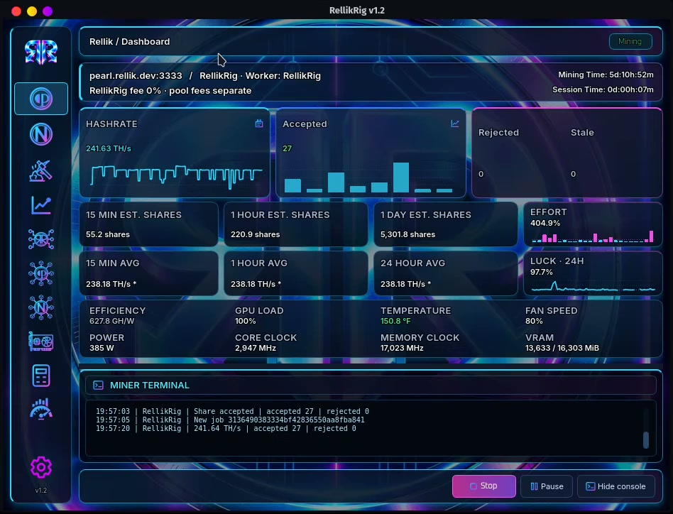
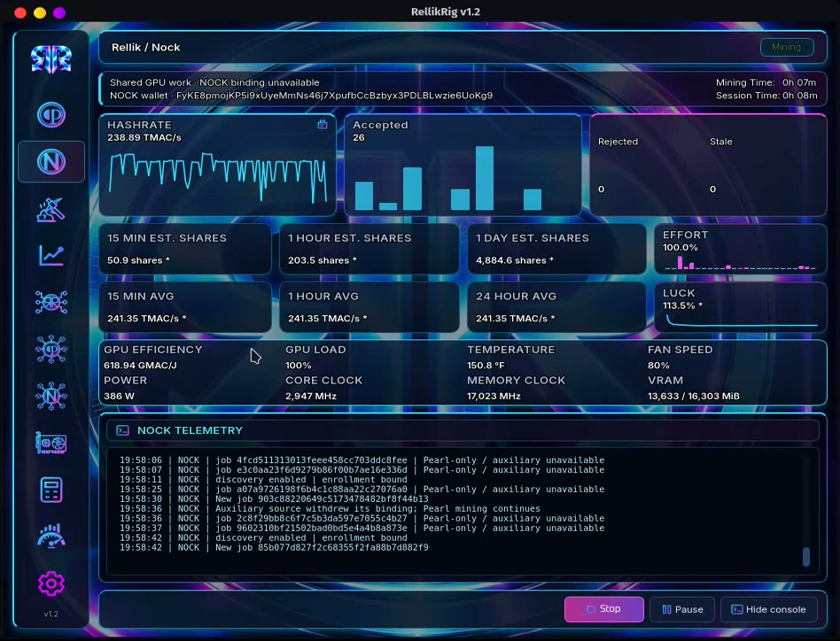

Linux settings — both scrollable sections

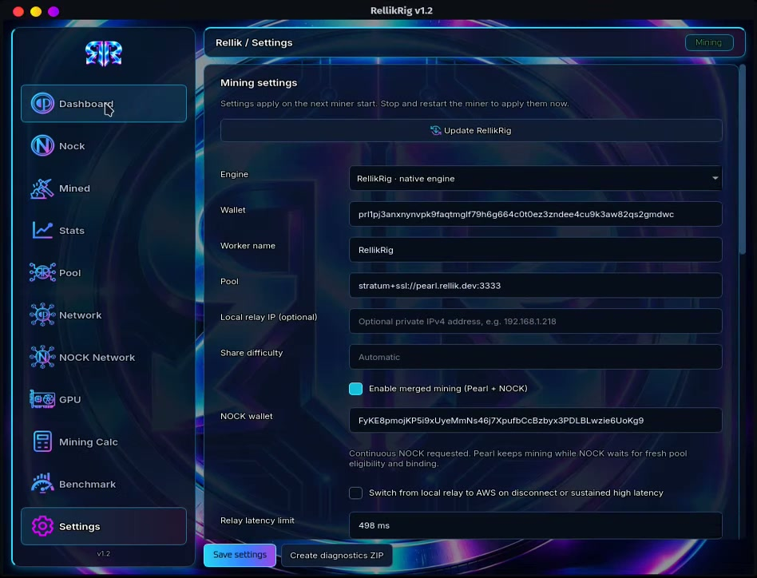
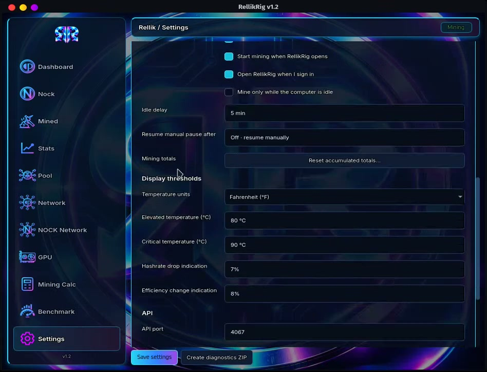

### Windows — v1.2 owner test

Owner-provided captures from the completed two-hour RTX 5080 test: **240.54 TH/s average**, **388.15 W**, **73.08°C average / 76°C maximum**, 502 accepted Pearl shares and five stale shares (zero other rejections). The export records **427 confirmed NOCK receipts**. Intermittent NOCK binding pauses remain a Beta limitation; this run does not establish uninterrupted auxiliary availability.

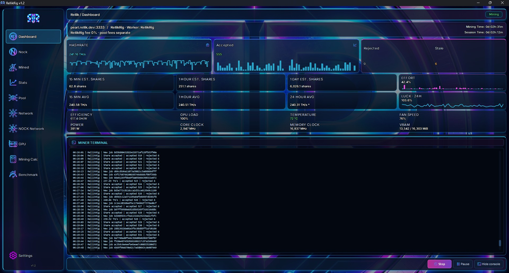
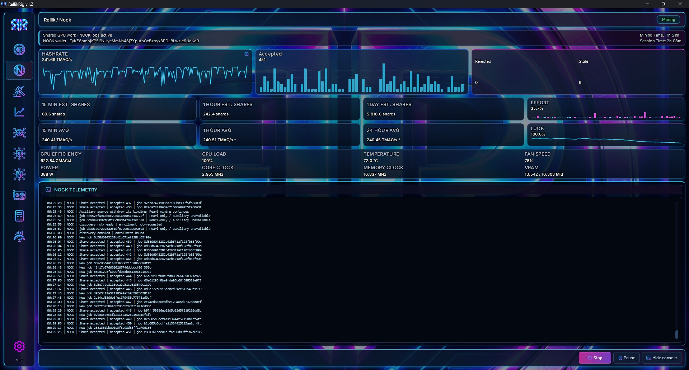
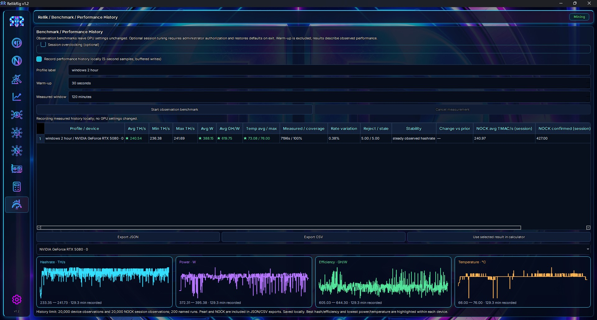

Windows settings — both scrollable sections

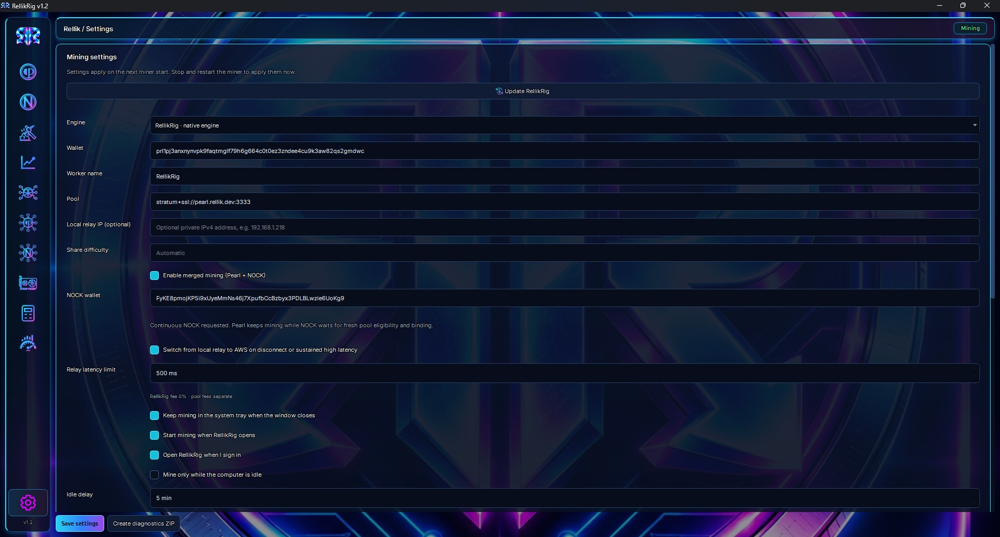
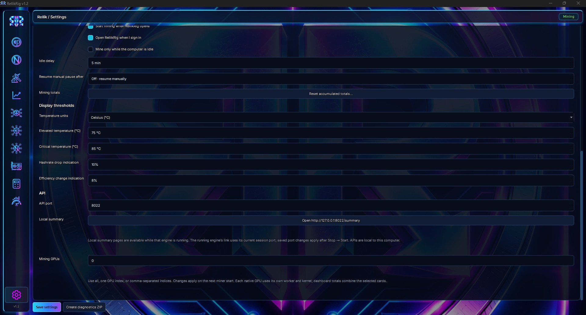

### Mac

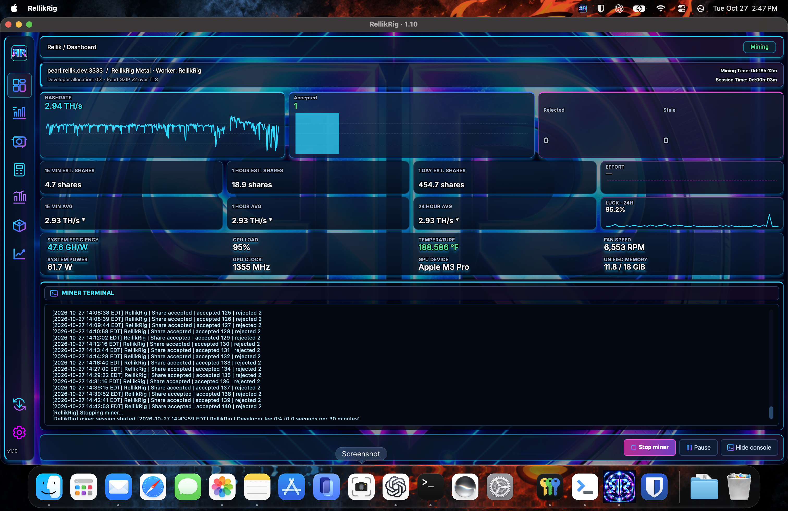
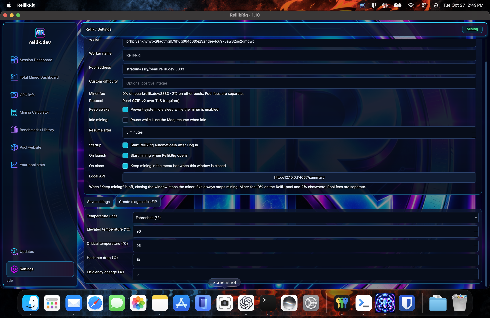

[Full gallery: session/total dashboards, expanded navigation, GPU info, settings, calculator, updates, and benchmark screens](docs/v1.10/README.md)

## API, privacy, and troubleshooting

One local API port is shared by the selected engine on Windows/Linux, default `4067`; only one should be active. The running session's summary link keeps its active port until Stop → Start. Mac exposes its local native summary at `http://127.0.0.1:4067/summary`. Loopback APIs are local and do not open router/firewall ports.

Mining traffic goes to the configured pool. Calculator refreshes contact the compatible public pool/network/price feed; update checks/downloads contact GitHub; external links open your browser. Local history/benchmarks are opt-in; there is no separate analytics upload. The default wallet is public and editable. Diagnostic exports redact wallet information; review any diagnostic before sharing it.

If the app cannot launch, extract the whole package again and check OS/architecture. For missing NVIDIA telemetry, test `nvidia-smi`. For occupied API ports, stop another instance or select a free port. For rejected shares, report the selected engine, pool protocol, version, and exact rejection reason; connected does not necessarily mean compatible. Do not run old and new releases together. Updates are user initiated and verify downloaded packages. If an older installation does not offer v1.22, use the current Windows installer or a full manual download; preserve your external UserData and benchmark history.

Submit issues with OS, driver, device, selected engine, and error text at [GitHub Issues](https://github.com/RellikRig/RellikRig-Pearl/issues). See [SUPPORT.md](SUPPORT.md) and [SECURITY.md](SECURITY.md).

## License and source availability

RellikRig implementation source remains private. Application and controller modules are compiled to native machine code, rather than distributed as packaged Python bytecode. Native compilation makes recovery harder; it does not make reverse engineering impossible. This repository distributes public documentation, owner-provided screenshots/benchmark exports, notices, and compiled release packages only. GitHub's automatic “Source code” ZIP/TAR assets contain this **documentation repository**, not the miner implementation.

See [LICENSE.txt](LICENSE.txt), [THIRD_PARTY.md](THIRD_PARTY.md), and bundled component notices. Qt/PySide LGPL rights and third-party licenses remain applicable.
