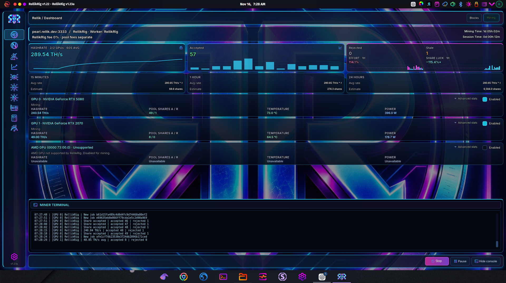
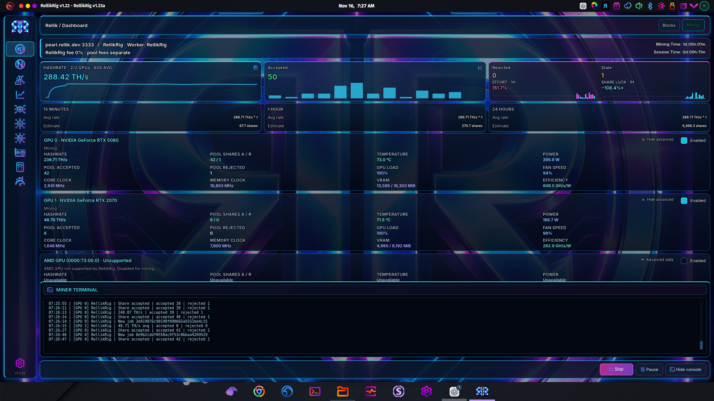
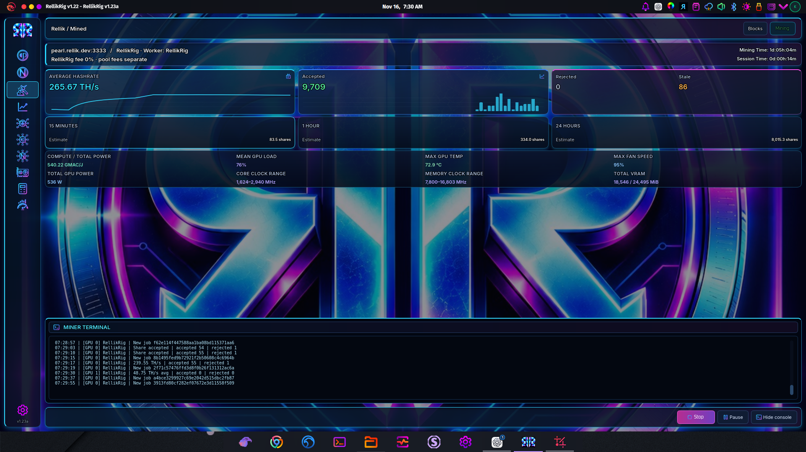

# RellikRig

**Pearl (PRL) GPU miner** for Windows and Linux, with an Apple Silicon preview for macOS and optional **NOCK merge mining** (beta).

Clean desktop GUI • Live statistics • Idle-aware mining • System tray controls  
**0% developer fee** when mining on the official Rellik pool

[Try v1.23a RC1](https://github.com/RellikRig/RellikRig-Pearl/releases/tag/v1.23a-rc1) · [Get v1.22 for Windows or Linux](https://github.com/RellikRig/RellikRig-Pearl/releases/tag/v1.22) · [Changelog](CHANGELOG.md) · [Pool Dashboard](https://pearl.rellik.dev)

---

### Follow for Updates

- **X / Twitter:** [@rellikdev](https://x.com/rellikdev)
- **TikTok:** [@rellik.dev](https://www.tiktok.com/@rellik.dev)
- **Reddit:** [u/RellikDev](https://www.reddit.com/u/RellikDev)
- **Email Support:** [rellikdev@gmail.com](mailto:rellikdev@gmail.com)

---

  
*The v1.23a dashboard shows each card’s speed, shares, temperature, and power.*

**Getting Started (sped up):**

---

### What’s new in v1.23a RC1

- **Multi-GPU support:** Choose which supported cards mine. Run them together or leave one free for gaming. See stats for each card.
- **RTX 2070 tuning:** Improved RTX 2070 support. Supported RTX 20-series setups can mine Pearl and NOCK together on Rellik Pool.
- **Easier to read:** Steadier efficiency readings, improved Mined and Pool Stats views, and separate counts for confirmed NOCK work.
- **Apple Silicon preview:** Mine Pearl and NOCK together on Rellik Pool. External pools aren’t supported in this build, and the app isn’t Developer ID-signed or notarized.

RC1 is a release candidate. Choose the **Windows portable EXE**, **Linux AppImage**, **Ubuntu 26.04 DEB**, or **macOS Apple Silicon ZIP** from [RC1 downloads](https://github.com/RellikRig/RellikRig-Pearl/releases/tag/v1.23a-rc1#assets). The release notes list known issues, checksums, and antivirus scan results. The legacy downloads below are unchanged.

### Quick Start (previous releases)

1. Download the correct package for your platform (see table below)
2. Extract the full archive
3. Open **Settings** and **replace the prefilled wallet** with your own PRL receiving address
4. (Optional) Enable NOCK merge mining and enter your NOCK wallet
5. Click **Start miner**

| Platform                    | Package                                                                 | How to run              |
|----------------------------|--------------------------------------------------------------------------|-------------------------|
| Windows (Installer)        | [Install-RellikRig-Windows-1.22.zip](https://github.com/RellikRig/RellikRig-Pearl/releases/download/v1.22/Install-RellikRig-Windows-1.22.zip) | Run the installer       |
| Windows (Portable)         | [RellikRig-Windows-1.22.zip](https://github.com/RellikRig/RellikRig-Pearl/releases/download/v1.22/RellikRig-Windows-1.22.zip) | `RellikRig.exe`         |
| Linux                      | [RellikRig-Linux-1.22.zip](https://github.com/RellikRig/RellikRig-Pearl/releases/download/v1.22/RellikRig-Linux-1.22.zip) | `./RellikRig`           |
| macOS (Apple Silicon)      | [RellikRig-Mac-1.10.zip](https://github.com/RellikRig/RellikRig-Pearl/releases/download/v1.10/RellikRig-Mac-1.10.zip) | `RellikRig.app` (v1.10) |

Always verify the [SHA-256 checksums](https://github.com/RellikRig/RellikRig-Pearl/releases/download/v1.22/RELEASE-SHA256SUMS.txt) after downloading.

**Default pool:** `stratum+ssl://pearl.rellik.dev:3333`

---

<strong>More Screenshots (v1.23a)</strong>

**Advanced multi-GPU view**  

**Mined**  

<strong>Previous Screenshots (v1.22)</strong>

**Dashboard**  

**Mining Settings**  
  
*Wallet, primary/backup pool, and engine configuration*

**NOCK Merge Mining Settings**  
  
*Enable Pearl + NOCK merge mining and set your NOCK wallet*

**NOCK Tab (Active Mining)**  
  
*Shared GPU work and confirmed NOCK receipts*

**GPU Info**  

**Mining Calculator**  

---

### Tested Hardware

**v1.23a test results**

| Hardware | Where it was tested | What we observed |
|---|---|---|
| GeForce RTX 5080 (16 GB) | Garuda Linux, alongside the RTX 2070 | About **240–242 TH/s** on Pearl, with accepted shares. |
| GeForce RTX 2070 (8 GB) | Garuda Linux, alongside the RTX 5080 | About **49 TH/s** on Pearl, with accepted shares. |
| GeForce RTX 2070 (8 GB) | Ubuntu 26.04.1 LTS, AppImage and DEB | Both packages started mining and recorded accepted Pearl shares. NOCK receipts were not confirmed in those tests. |
| MacBook Pro (M3 Pro) | Apple Silicon preview | An earlier preview ran for **14 hours** with **266 accepted shares**. The replacement RC1 ZIP passed offline checks, but that live result is from the earlier build. |

The RTX 5080 and RTX 2070 were also tried on Windows 11. See the [RC1 known issues](https://github.com/RellikRig/RellikRig-Pearl/releases/tag/v1.23a-rc1#known-issues) for the Windows mining and Stop issues. The rates above are Garuda observations, not Windows or Ubuntu benchmarks.

<strong>Earlier NVIDIA benchmarks</strong>

| GPU | VRAM | Observed Pearl hashrate |
|---|---|---|
| NVIDIA H100 SXM | 80 GB | 221.98 TH/s |
| NVIDIA RTX PRO 4500 Blackwell | 32 GB | 154.96 TH/s |
| NVIDIA RTX A6000 | 48 GB | 89.13 TH/s |

Results vary with drivers, power limits, and cooling. These tests don’t establish support for every GPU combination or confirm NOCK payouts.

### Features

- Native RellikRig mining engine (NVIDIA on Windows/Linux)
- Live dashboard with hashrate, shares, GPU monitoring, and terminal
- Primary + backup pool failover with automatic return
- Idle-aware mining (automatically pauses while you're using the PC)
- System tray controls and optional start-on-launch
- Built-in mining calculator and benchmark history
- Optional **NOCK merge mining** (Beta)
- Persistent settings and mining totals outside the install folder

---

### What is Merge Mining?

Merge mining allows you to mine **two coins at the same time** with the same GPU hashrate, without needing extra hardware or significantly higher power draw.

In RellikRig this means:

- You mine **Pearl (PRL)** as the primary coin
- At the same time, the miner can also submit work for **NOCK**
- You earn potential rewards from both chains using the same GPU effort

Simply enable the feature in Settings and add your NOCK wallet address.

**Note:** NOCK merge mining is currently in **Beta**. Pearl mining continues even if NOCK work is temporarily unavailable. You may experience occasional pauses in the auxiliary work and incomplete pool-side statistics while the feature matures.

---

### Fees

| Engine                        | RellikRig Developer Fee     |
|------------------------------|-----------------------------|
| Native engine on Rellik Pool | **0%**                      |
| Native engine on other pools | **2%**                      |

Pool fees are separate. The official Rellik Pool currently charges **1%**.

---

### NOCK Merge Mining (Beta)

1. Go to **Settings**
2. Enable merged mining (Pearl + NOCK)
3. Enter your own **NOCK** receiving address
4. Save settings and restart the miner

Pearl mining continues running even if NOCK work pauses. Local shared GPU work is shown in MAC/s or TMAC/s.

---

### Important Notes

- **Set your own receiving addresses** before you start mining. If an older build has a prefilled wallet, replace it with yours.
- Cryptocurrency miners are frequently flagged by antivirus software. Only download from this official repository and always verify checksums.
- Windows and Linux builds require a recent NVIDIA driver.
- This is closed-source software.

---

### Support & Contact

- **Email:** [rellikdev@gmail.com](mailto:rellikdev@gmail.com)
- **X:** [@rellikdev](https://x.com/rellikdev)
- **TikTok:** [@rellik.dev](https://www.tiktok.com/@rellik.dev)
- **Reddit:** [u/RellikDev](https://www.reddit.com/u/RellikDev)
- Additional support details: [SUPPORT.md](SUPPORT.md)

---

### Licensing

See [Licensing](LICENSING.md).
