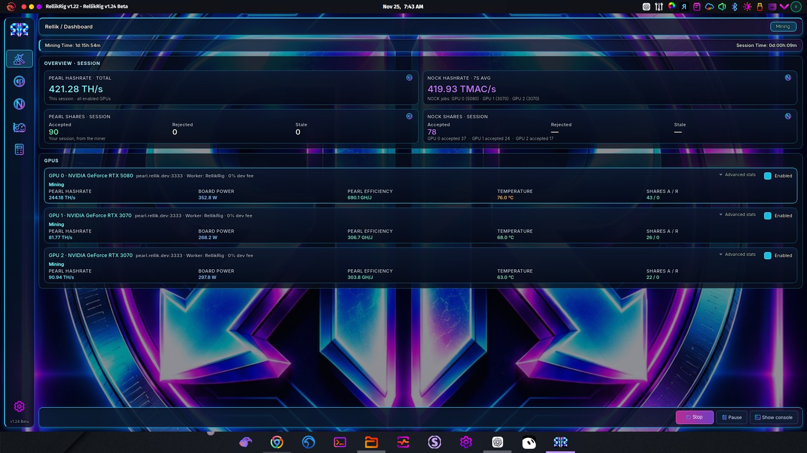
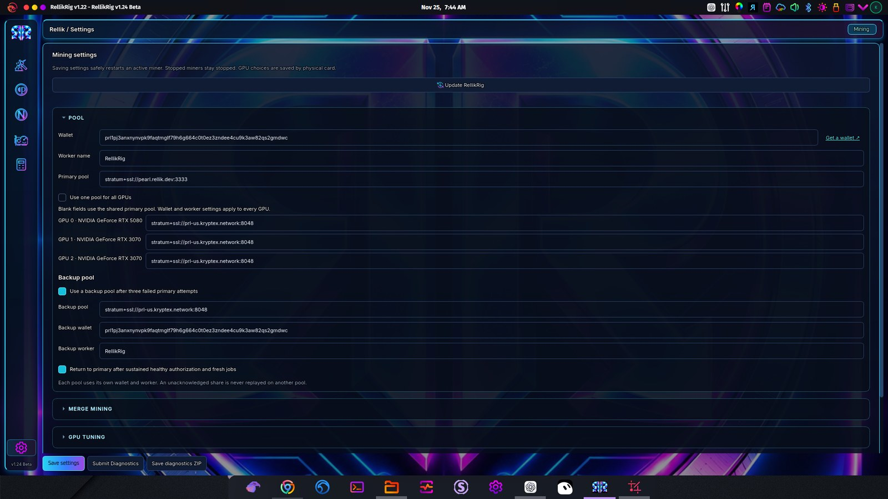
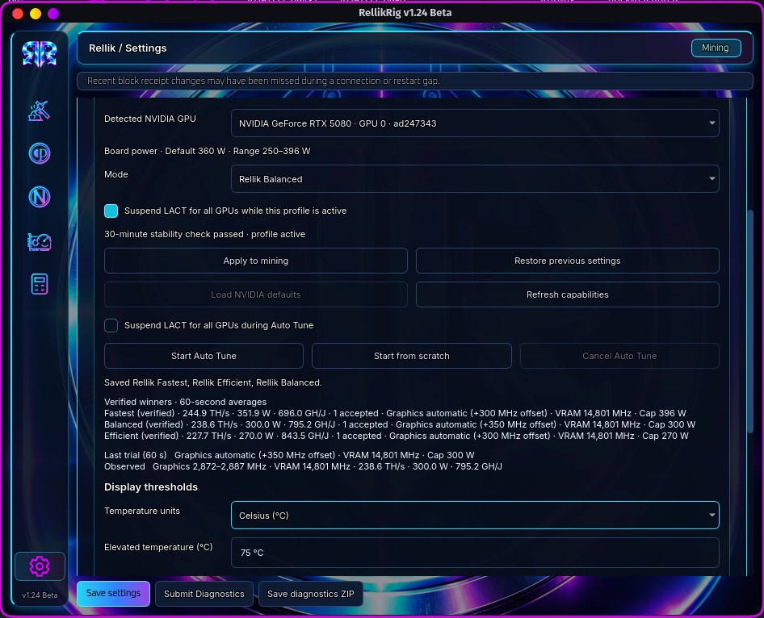
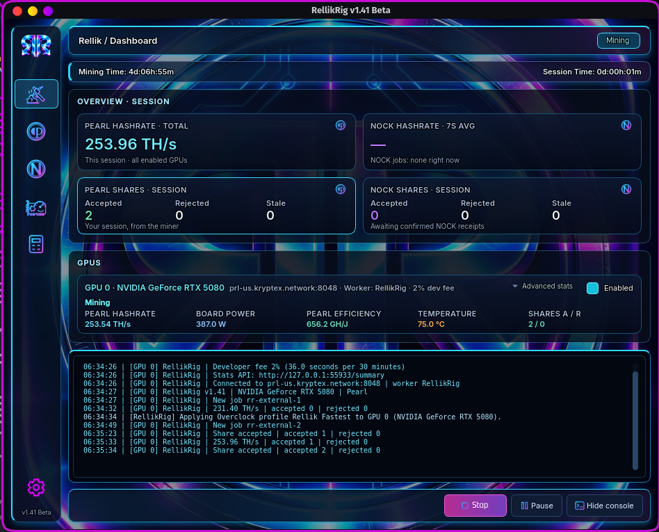
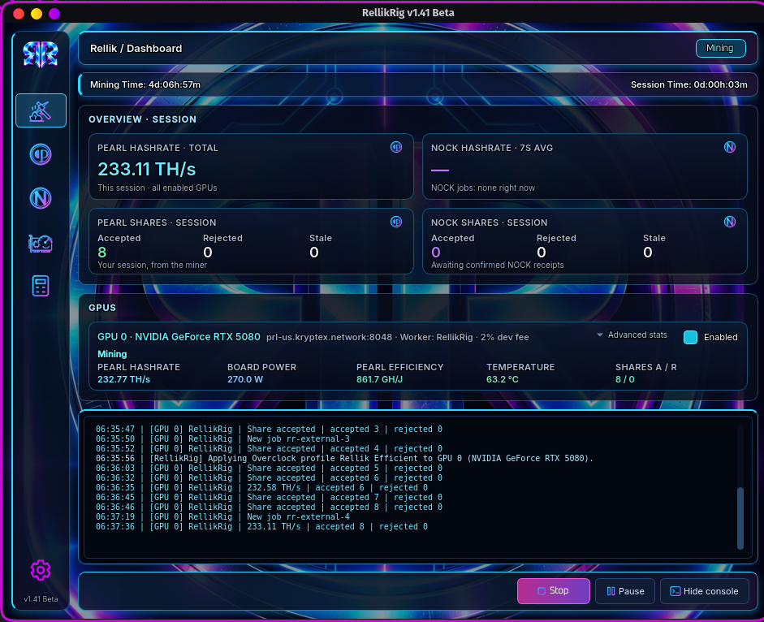
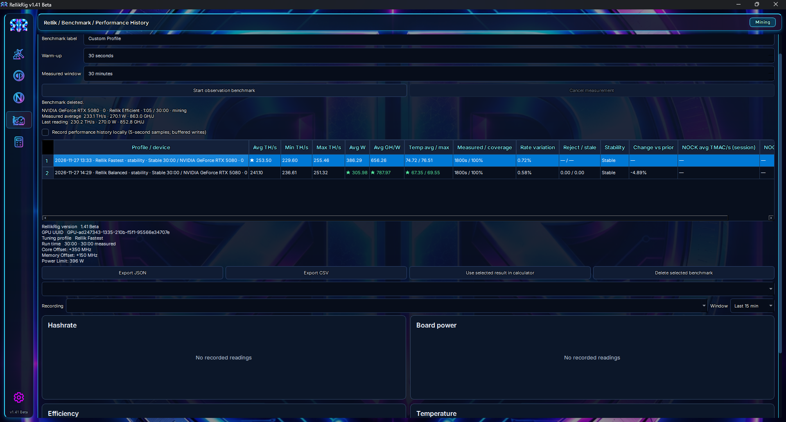
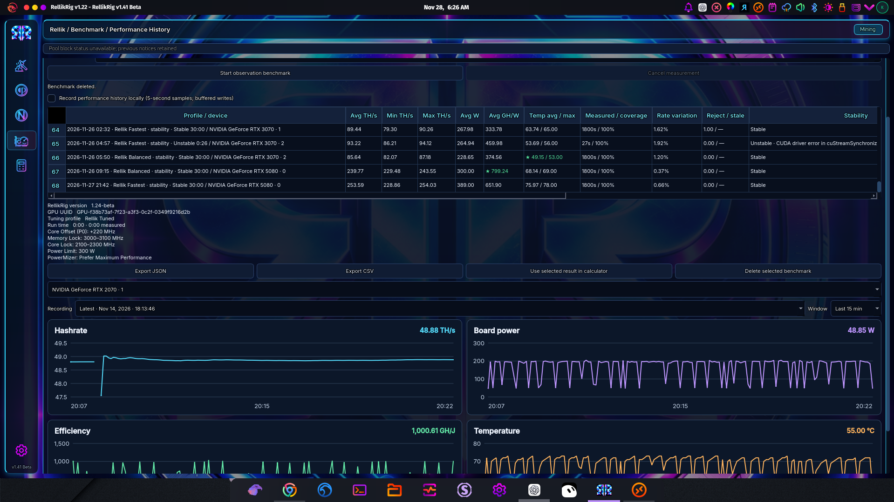

# RellikRig

**Pearl (PRL) GPU mining with a desktop interface built for everyday PCs and multi-GPU rigs.** Choose which cards mine, see how each one is doing, and use idle-aware mining to make room for gaming and normal PC use.

**v1.41 Beta for Linux** includes per-GPU pools and **Live Auto Tune**. Earlier Windows releases and the Apple Silicon preview remain available below. Optional **NOCK merge mining** is still in beta.

Multi-GPU support • Live Auto Tune • Per-card pools and stats • Idle-aware mining • System tray controls  
**0% developer fee** when mining on the official Rellik Pool

[Download v1.41 Beta for Linux](https://github.com/RellikRig/RellikRig-Pearl/releases/tag/v1.41) · [Earlier Windows/Linux release](https://github.com/RellikRig/RellikRig-Pearl/releases/tag/v1.23b-rc) · [Changelog](CHANGELOG.md) · [Pool Dashboard](https://pearl.rellik.dev)

---

### Follow for Updates

- **X / Twitter:** [@rellikdev](https://x.com/rellikdev)
- **TikTok:** [@rellik.dev](https://www.tiktok.com/@rellik.dev)
- **Reddit:** [u/RellikDev](https://www.reddit.com/u/RellikDev)
- **Email Support:** [rellikdev@gmail.com](mailto:rellikdev@gmail.com)

---

### See RellikRig in action

---

### What’s new in v1.4 beta

#### Multi-GPU Support — your cards, your choice

**Run supported GPUs together, or leave one free for gaming.** RellikRig detects your cards, remembers which ones you enable, and gives each GPU its own mining controls and statistics.

- **Different pools for different GPUs:** Send supported cards to different Pearl pools at the same time, or use one pool for the whole rig.
- **Pool choices stay with the card:** Your assignments follow the GPU even if the system lists your cards in a different order.
- **Clearer GPU cards:** Check each card’s speed, accepted shares, temperature, power, and efficiency. Expand a card for clocks, fan speed, load, and memory use.

Split your rig between compatible Pearl pools to suit how you want to mine. NOCK availability still depends on the selected pool and the work it provides.

#### Live Auto Tune — find a profile for each GPU

Try supported graphics and memory clock settings **while the selected GPU is mining**, then compare three profiles:

| Profile | What it aims for |
|---|---|
| **Fastest** | The highest measured mining speed among the tested settings. |
| **Balanced** | A balance between mining speed and power use. |
| **Efficient** | The best measured work per unit of energy among the tested settings. |

Auto Tune uses the settings available for that card and checks candidates for stability before saving them. Profiles belong to the GPU they were tested on. **Linux Auto Tune supports GeForce RTX 20, 30, 40, and 50 series**, subject to the controls available through your card and driver.

**Changing GPU overclock settings requires administrator rights.**

**Mining-only tuning:** During normal Pause or Stop, RellikRig clears its own clock overrides so your existing GPU settings can take over again. The Linux options to suspend LACT affect **all GPUs**, as labeled in Settings. Driver failures can still require manual recovery.

#### Benchmarks you can compare later

- **30-minute profile benchmarks:** Compare hashrate, power, efficiency, and temperature over a longer run.
- **Live measurements and saved history:** Review results later when choosing a profile.
- **Keep interrupted results:** Measurements are preserved if a benchmark ends before it finishes.

#### Live profile examples

**Fastest**

**Efficient**

#### 30-minute benchmark results

These results are from three completed 30-minute stability benchmarks on one NVIDIA GeForce RTX 5080 using RellikRig v1.41 Beta. Values are measured averages.

| Auto Tune profile | Pearl hashrate | Board power | Efficiency | GPU temperature |
|---|---:|---:|---:|---:|
| Fastest | 253.50 TH/s | 386.29 W | 656.26 GH/W | 74.72 °C |
| Balanced | 241.10 TH/s | 305.98 W | 787.97 GH/W | 67.35 °C |
| Efficient | 232.32 TH/s | 270.00 W | 860.46 GH/W | 64.27 °C |

Results vary with the GPU, drivers, cooling, power limits, and workload.

#### Better recovery when a run hits trouble

- **Worker retries:** GPU workers keep retrying after disconnects and recoverable mining errors.
- **Remember failed settings:** Auto Tune records settings that fail, helping it avoid repeating the same bad combination.
- **Return to a working profile:** When recovery succeeds, tuning returns to the last stable clocks. A driver that remains unavailable may still need a reboot.

Grouped settings, the first-run wallet reminder, diagnostics ZIPs, basic charts, and manual update checks remain available. These build on earlier releases.

### Download and quick start

**Current Linux release — v1.41 Beta**

| Platform | Download | How to run |
|---|---|---|
| Linux x86-64, including Arch and Debian-based distributions | [v1.41 Beta AppImage](https://github.com/RellikRig/RellikRig-Pearl/releases/download/v1.41/RellikRig-1.41-x86_64.AppImage) | Make it executable, then open it. |
| Ubuntu / Debian amd64 | [v1.41 Beta DEB package](https://github.com/RellikRig/RellikRig-Pearl/releases/download/v1.41/rellikrig_1.41_amd64.deb) | Install the package, then open RellikRig. |

1. Download the package for your system and verify it against the [v1.41 SHA256SUMS](https://github.com/RellikRig/RellikRig-Pearl/releases/download/v1.41/SHA256SUMS).
2. Open **Settings → Pool** and enter your own Pearl receiving address. Review any settings kept from an earlier installation.
3. Use a shared pool for all cards, or turn off **Use one pool for all GPUs** and set each card’s pool. Empty per-card pool fields use the shared primary pool.
4. Select the GPUs you want to use. Optionally enable Pearl + NOCK and enter your own NOCK receiving address.
5. Save your settings and click **Start miner**.

**To try Auto Tune:** Start mining on the card first, select it under **GPU Tuning**, then choose **Start Auto Tune**. Review the results and compare the saved profiles before choosing one to use.

**Default pool:** `stratum+ssl://pearl.rellik.dev:3333`

[Full v1.41 Beta release notes](https://github.com/RellikRig/RellikRig-Pearl/releases/tag/v1.41) · [All releases](https://github.com/RellikRig/RellikRig-Pearl/releases)

<strong>Earlier Windows, Linux, and macOS downloads</strong>

These are separate releases. The new Linux Auto Tune features do not imply equivalent Windows or macOS support.

| Platform | Earlier download | Version |
|---|---|---|
| Windows x64 | [Portable EXE](https://github.com/RellikRig/RellikRig-Pearl/releases/download/v1.23b-rc/RellikRig-Windows-1.23b-RC.exe) | v1.23b RC |
| Linux x86-64 | [AppImage](https://github.com/RellikRig/RellikRig-Pearl/releases/download/v1.23b-rc/RellikRig-1.23b-x86_64.AppImage) | v1.23b |
| Ubuntu amd64 | [DEB package](https://github.com/RellikRig/RellikRig-Pearl/releases/download/v1.23b-rc/rellikrig_1.23b_amd64.deb) | v1.23b |
| macOS Apple Silicon | [Earlier preview assets](https://github.com/RellikRig/RellikRig-Pearl/releases/tag/v1.23a-rc1#assets) | v1.23a RC1 |

Use the checksum list for the exact release: [v1.23b SHA256SUMS](https://github.com/RellikRig/RellikRig-Pearl/releases/download/v1.23b-rc/SHA256SUMS) or the [v1.23a RC1 assets](https://github.com/RellikRig/RellikRig-Pearl/releases/tag/v1.23a-rc1#assets). [v1.22 downloads](https://github.com/RellikRig/RellikRig-Pearl/releases/tag/v1.22) also remain available.

---

### Hardware and testing

The v1.4 beta release describes Linux Auto Tune support for **GeForce RTX 20, 30, 40, and 50 series**. Available tuning controls depend on the individual GPU and driver.

The supplied interface previews show an **RTX 5080 and two RTX 3070s** with independent controls and pool assignments. Earlier per-card mining profile work was tested on the **RTX 2070, RTX 3070, and RTX 5080**. These observations do not establish that every model or combination has been tested, or that every card has completed a long Auto Tune run.

<strong>Earlier v1.23b testing</strong>

- **Garuda Linux:** The v1.23b AppImage was tested on Garuda.
- **Ubuntu 24.04:** The v1.23b AppImage and DEB passed container startup checks. Those checks do not establish live GPU mining on Ubuntu or test the newer v1.4 packages.
- **Windows:** In v1.23b, RTX 3070 and RTX 5080 workers started. The RTX 2070 passed offline proof and local submission checks; live Windows mining on that card was not verified for that build.

<strong>Earlier NVIDIA benchmarks</strong>

| GPU | VRAM | Observed Pearl hashrate |
|---|---|---|
| NVIDIA H100 SXM | 80 GB | 221.98 TH/s |
| NVIDIA RTX PRO 4500 Blackwell | 32 GB | 154.96 TH/s |
| NVIDIA RTX A6000 | 48 GB | 89.13 TH/s |

These historical results are not v1.4 Auto Tune benchmarks.

Results vary with drivers, power limits, cooling, and workload. A saved profile is a measured result, not a guarantee of speed, stability, uptime, or earnings.

### Features

- Native RellikRig mining engine for NVIDIA GPUs on Windows/Linux, with version-specific platform support
- Independent GPU selection, per-card stats, and remembered settings
- Per-GPU pool choices and Live Auto Tune in the Linux v1.4 beta
- Live dashboard, smoothed efficiency readings, and an expandable console
- Primary and backup pool settings
- Idle-aware mining, pause/resume, and system tray controls
- Optional start-on-launch
- Mining calculator, benchmarks, and saved performance history
- Grouped settings, a first-run wallet reminder, and diagnostics export
- Optional **NOCK merge mining (beta)**
- Persistent settings and mining totals outside the install folder

---

### What is Merge Mining?

Merge mining uses shared GPU work to submit work for **Pearl and NOCK** without adding another GPU.

- Pearl is the primary coin.
- When compatible NOCK work is available, the miner can also submit work for NOCK.
- Rewards depend on accepted work and the applicable pool rules. Speed, power use, and earnings vary.

NOCK remains in **beta**. Mining can fall back to Pearl only, and NOCK statistics can lag or be unavailable.

---

### Fees

| Where a GPU mines | RellikRig developer fee |
|---|---|
| Rellik Pool | **0%** |
| Other pools | **2%** |

Pool fees are separate. The official Rellik Pool currently charges **1%**. With per-GPU pools, the developer fee follows the pool each card uses.

---

### NOCK Merge Mining (Beta)

1. Open **Settings → Merge Mining**.
2. Enable **Pearl + NOCK**.
3. Enter your own NOCK receiving address.
4. Save your settings and apply them to the mining session.

The dashboard shows which GPUs have NOCK jobs. Local shared work may be shown in MAC/s or TMAC/s; **that activity is separate from verified, committed NOCK receipts**. Receipts are attributed per card when known, or shown as shared receipts otherwise.

**An incoming job is not a confirmed receipt, and a receipt is not a wallet payment.** Check pool credit and payouts separately. Selecting a Pearl pool for a card does not by itself establish NOCK support on that pool.

---

### Important Notes

- **v1.41 Beta is a Linux release.** No new Windows or macOS package is included in this release.
- **Auto Tune changes GPU clocks.** Stability checks can catch failed settings, but some driver failures still need a reboot. Recovery is not guaranteed.
- **Use your own receiving addresses.** Review saved wallet and pool settings before starting.
- **Use a recent NVIDIA driver** and the tuning controls supported by your card.
- Download only from the official repository and verify the matching checksums. Follow the known issues for the exact release you use.
- This is closed-source software.

---

### Support & Contact

Report issues to **[rellikdev@gmail.com](mailto:rellikdev@gmail.com)**. Include the app version, operating system, GPU and driver, pool, and what happened. For a tuning issue, say which card and profile were selected.

Use **Save diagnostics ZIP** or **Submit Diagnostics** in Settings when helpful. Review the file before sharing and remove wallet addresses, account details, private paths, and credentials. Never share private keys or seed phrases.

- **Email:** [rellikdev@gmail.com](mailto:rellikdev@gmail.com)
- **X:** [@rellikdev](https://x.com/rellikdev)
- **TikTok:** [@rellik.dev](https://www.tiktok.com/@rellik.dev)
- **Reddit:** [u/RellikDev](https://www.reddit.com/u/RellikDev)
- Additional support details: [SUPPORT.md](SUPPORT.md)

---

[Proprietary license and third-party notices](LICENSING.md)
