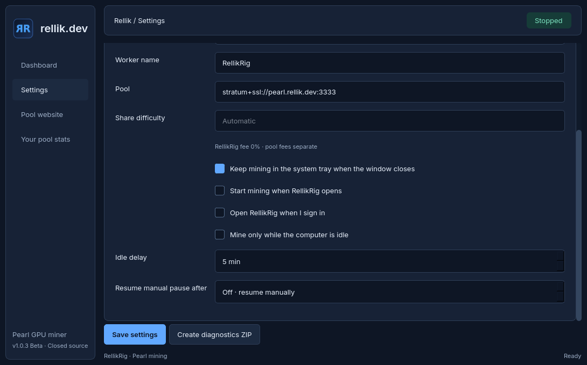
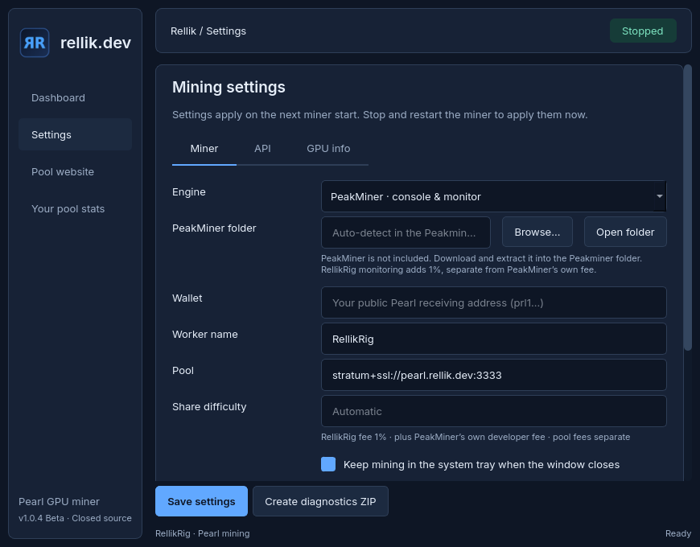
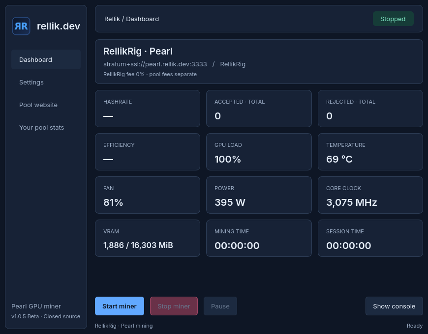
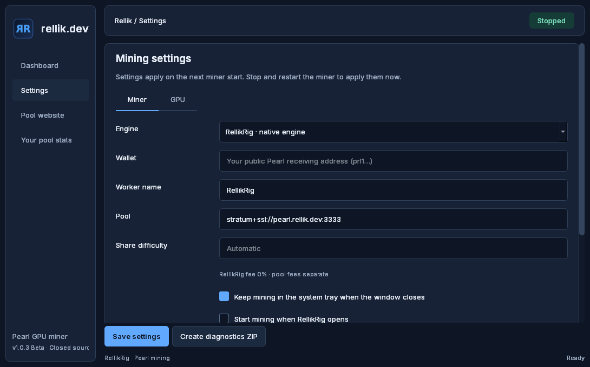
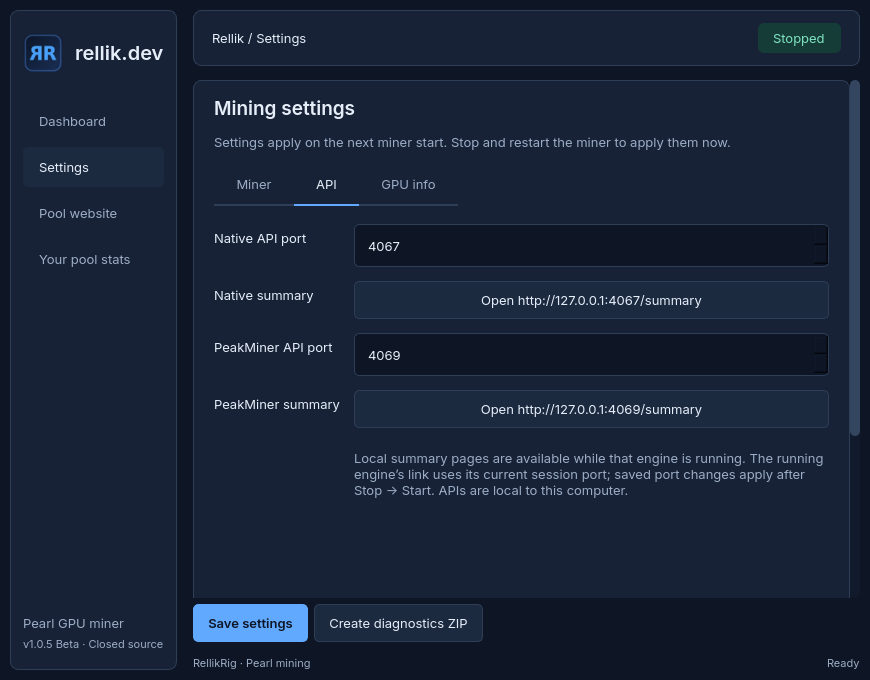
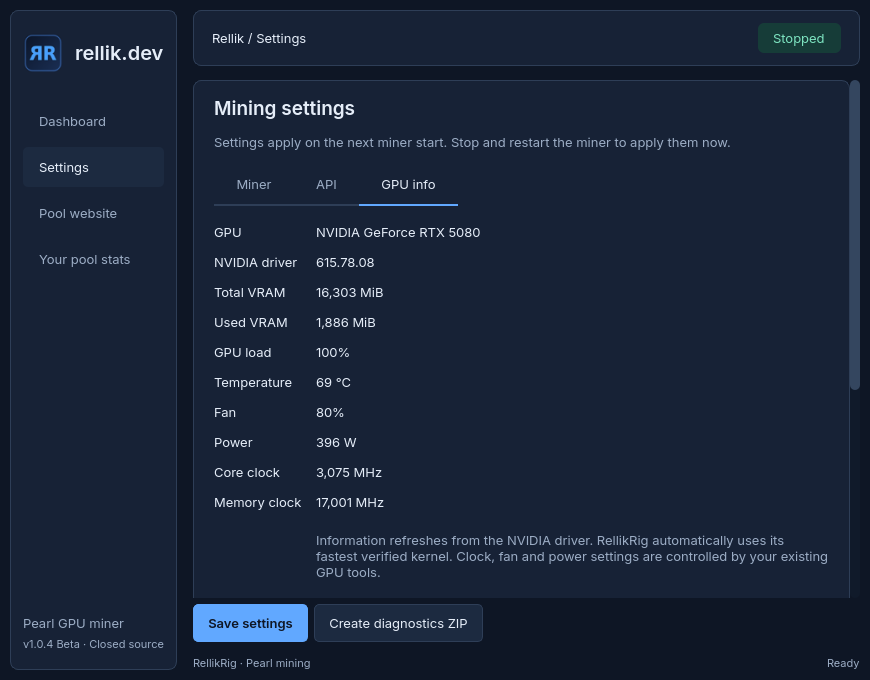

# RellikRig · Pearl GPU mining

Closed-source Pearl mining applications for NVIDIA GPUs on Windows/Linux and Apple silicon Macs.

## Mac · 1.07 RC

[Download RellikRig Mac 1.07 RC](https://github.com/RellikRig/RellikRig-Pearl/releases/tag/v1.07-rc) · [Mac installation and usage guide](docs/Mac-1.07-RC.md)

Extract the ZIP and launch **RellikRig.app**, or drag it into Applications. No Python, Rust, Xcode, or terminal setup is required. This is an arm64 Apple silicon app; it was tested on an **M3 Pro MacBook Pro with 18 GB RAM**, where the retained engine measured **3.02 TH/s over ten minutes**. Actual rates depend on the machine and workload. The app is locally signed and is not Developer ID notarized.

The default pool is `stratum+ssl://pearl.rellik.dev:3333`. Native miner fees match the NVIDIA build: **0% on that Rellik endpoint and 2% on other compatible pools**; pool fees remain separate. A fresh installation has an empty wallet and automatic mining disabled. The Mac package includes its Metal engine, compact dashboard, console, pause/resume, idle controls, and local API. PeakMiner monitoring remains a Windows/Linux feature; PeakMiner is never bundled.

Only compiled app files and public documentation/notices are distributed. RellikRig implementation source remains private.

## Windows and Linux · 1.07 RC

Version 1.07 RC is the unified release for Windows, Linux and Apple silicon Mac. The remaining sections describe the Windows/Linux packages; use the Mac guide above for platform-specific instructions.

A closed-source Pearl GPU miner and desktop monitor for Windows and Linux, styled to match [Rellik’s Pearl pool](https://pearl.rellik.dev/).

RellikRig includes its native NVIDIA engine, an optional PeakMiner runner, live GPU statistics, an embedded console, and system tray controls. This release is Pearl-only; it contains no Monero or NOID CPU miner.

This release brings matching dashboard layouts across Windows, Linux and Mac, with Current Session and Total Mining Time views, accepted/rejected/stale counters, rolling averages, chart history, pause/resume, idle mining and an interactive console.

## Download and run

Download your platform archive and `SHA256SUMS.txt` from the [1.07 RC release](https://github.com/RellikRig/RellikRig-Pearl/releases/tag/v1.07-rc). This is a release candidate. Verify the archive against the published checksums before running it.

| Platform | Archive | Launch |
|---|---|---|
| Windows x64 | `RellikRig-Windows-1.07-RC.zip` | Extract the whole folder, then open `RellikRig.exe` |
| Linux x64 | `RellikRig-Linux-1.07-RC.zip` | Extract the whole folder, then run `./RellikRig` |

Keep `_internal` beside the executable. Python, Rust and the CUDA Toolkit are not required. An installed NVIDIA driver is required. The retained native profile was validated on an RTX 5080 with 16 GB VRAM; other packaged NVIDIA architectures have not received equivalent performance validation. The native RTX 5080 profile needs about 14 GB of available VRAM.

The 1.07 RC release includes archive integrity, source-exclusion, packaged fee behavior, dashboard regression and platform launch checks. Windows was hardware-tested by the release owner; this does not establish equivalent validation for every NVIDIA GPU or driver. The Mac package is locally signed, not Apple Developer ID notarized.

## First run

1. Open **Settings → Miner**.
2. Enter your public Pearl receiving address and a worker name. The default worker is `RellikRig`; the wallet starts blank.
3. Select **RellikRig · native engine**, or select PeakMiner and extract its download into the `Peakminer` folder beside RellikRig.
4. Review the pool, save settings, then click **Start miner** on the dashboard.

The default pool is `stratum+ssl://pearl.rellik.dev:3333`. TLS certificates are verified. Custom share difficulty is optional; leave it blank for the pool’s automatic settings. Alternate pools must support compatible Pearl V3 proof submissions.

You can edit and save settings while mining. The confirmation explains that saved mining settings apply on the next miner start; stop and restart the miner to apply them now. The current session keeps its engine, wallet, pool and API settings until then.

## Pause, resume and idle mining

Use **Pause / Resume** on the dashboard or in the tray menu. Pause stops the owned miner process to free the GPU; Resume reconnects with the same session settings. Accumulated shares, active session time and allocation clocks are preserved and do not advance while paused. A new **Start** after **Stop** resets Session Time as usual.

Under **Settings → Miner**, enable **Mine only while the computer is idle** and choose an **Idle delay** in minutes (5 by default). After Start, mining waits until that delay has elapsed without input, then pauses when you use the computer. It works while the app is minimized to the tray. The option is off by default.

**Resume manual pause after** optionally resumes a manual pause after the chosen number of minutes; **Off** keeps it paused until you click Resume. When idle mode is enabled, the idle requirement still applies after the timer expires. **Stop** cancels automatic resumes. Saved settings take effect on the next Stop → Start, including changes made while paused.

Idle detection uses Windows session input timing, the X11 idle extension, or the Wayland `ext-idle-notify` protocol (including Garuda/KDE). It observes idle state only, not typed text. If the desktop cannot report idle state, idle mode keeps mining paused and displays a status message; manual Pause/Resume remains available with idle mode disabled.

## Engines and fees

| Selected engine | Destination | RellikRig miner fee |
|---|---|---:|
| RellikRig native | `pearl.rellik.dev:3333` over TLS | **0%** |
| RellikRig native | Any other pool | **2%** |
| PeakMiner | Any pool | **1%**, additional to PeakMiner’s own developer fee |

Pool fees are separate. The Rellik pool currently charges a 1% pool fee on block rewards; a 0% RellikRig miner fee does not remove it. PeakMiner’s own fee is controlled by PeakMiner, not this application. For example, a 2% PeakMiner fee plus the 1% RellikRig allocation leaves approximately 97.02% for user mining before pool fees and restart overhead.

Native 2% allocation uses the final 36 seconds of each 30-minute cycle. The PeakMiner runner targets 18 seconds per 30 minutes of observed active mining, retains its allocation clock across app restarts, and returns to the user wallet afterward. Allocation describes mining time, not a fixed number of shares or guaranteed revenue. Connection and kernel initialization take additional time when switching payees.

Developer work uses the selected pool and the project wallet:

`prl1pj3anxnynvpk9faqtmglf79h6g664c0t0ez3zndee4cu9k3aw82qs2gmdwc`

If the user wallet is already the project wallet, the payee is unchanged. Fee policy is automatic, with no percentage input in Settings.

## Native RellikRig engine

The app automatically selects its retained, fastest verified native profile for the detected GPU. On the validated RTX 5080, this is the smaller-A / four-chain-fold kernel. There are no experimental kernel or CPU-engine choices in this release. GPU-generated winners are independently checked on the CPU before submission; ordinary CPU use for proof validation is still necessary.

RellikRig does not change GPU clocks, voltage, fan speed or power limits. Existing tuning tools remain in control. The native temperature guard stops mining at its configured safety threshold, 83°C by default.

## PeakMiner console and monitoring

Download PeakMiner separately from its [official releases](https://github.com/peakminer/peakminer/releases). Choose **PeakMiner · console & monitor** under **Miner**, and extract the download into the empty `Peakminer` folder beside RellikRig. The app detects its executable automatically, including an extracted subfolder. Keep one version in that folder. **Settings → Miner → Open folder** opens it. **Browse…** selects a PeakMiner executable at another location. On Linux, enable the executable permission on the downloaded file before using it.

RellikRig launches and stops the selected process, displays its stdout/stderr in **Show console**, and reads its local API for the dashboard. PeakMiner is proprietary and is not bundled or redistributed in these archives. Its own license and developer fee apply.

Stop a separately running GPU miner before starting a new session. If an API port is already occupied, select a free port under **Settings → API** or stop the other instance. RellikRig does not terminate unrelated miners.

## Dashboard and tray

The dashboard shows hashrate, efficiency, accumulated accepted and rejected shares, GPU load, temperature, fan, power, core clock, and VRAM.

- **Mining Time:** accumulated observed mining time, retained after stopping or exiting.
- **Session Time:** active mining time since the current Start action; resets on a new session.
- **Accepted / Rejected · Total:** accumulated counters across app-controlled mining sessions and both GPU engines. These are local observations, including allocation work, not pool payout accounting.

Mining time pauses while paused, stopped or disconnected. Totals are saved regularly and on a clean stop; an abrupt power loss can lose observations since the last save.

**Show console** also provides miner input. Type a command and press Enter or **Send command**, or use **Send key** to send text without Enter (for shortcuts such as `h`). Input goes to the running miner’s standard input, not a system shell. Supported commands and shortcuts depend on the miner; this does not add commands to engines that do not implement them.

The native console reports new jobs and accepted/rejected shares immediately, with a telemetry summary approximately once every 60 seconds. The dashboard and local API keep refreshing independently.

**Show console** opens the live output below the dashboard and expands the window within the available screen area. Metric cards and buttons retain their sizes; the dashboard scrolls on smaller screens.

Closing the window keeps mining in the tray when enabled. Right-click the tray icon for Show, Start, Pause/Resume, Stop, or **Exit RellikRig**. Exit stops the app’s mining processes. Startup at sign-in and mining on launch are optional and disabled by default.

**Pool website** opens the pool in your default browser. **Your pool stats** opens its lookup page and copies the active wallet address; paste it into the lookup field. The system browser and file manager launch with their own libraries, so bundled Qt files do not override KDE’s installed version.

## API and GPU information

Settings is organized into **Miner**, **API**, and **GPU info** tabs. The PeakMiner executable field, **Browse…**, **Open folder**, and download note appear in Miner only when PeakMiner is selected.

**API** contains both engine ports and buttons to open their local summary pages in your browser. For the engine currently mining, the link keeps using its active session port, even if you edit or save a different port for the next start. A summary page responds while its engine is running. **GPU info** shows the detected GPU, NVIDIA driver, VRAM, load, temperature, fan, power and clocks; it refreshes while mining is stopped too.

## Local API and saved settings

| Engine | Default local summary |
|---|---|
| RellikRig native | `http://127.0.0.1:4067/summary` |
| PeakMiner | `http://127.0.0.1:4069/summary` |

The app uses loopback APIs; it does not open firewall ports or expose them to the LAN. No analytics service is used. Your configured pool receives mining traffic, and opening a website link uses your browser.

Settings and logs are stored in the user’s application configuration directory under `RellikRig-1/settings.json`; the exact location follows Qt’s platform configuration path. Mining time and share totals are stored there too. This beta uses its own configuration and does not overwrite an earlier CPU-enabled installation’s settings or stop its CPU services.

## Troubleshooting

Beta 2 fixes a Windows startup check that incorrectly reported unused API ports as occupied. The native server now attempts the actual bind and reports the operating system error if it cannot open the API.

Use **Settings → Create diagnostics ZIP** to export the version, GPU details, recent console output and local summary. Wallet addresses are redacted in that export. Report issues with OS, driver, GPU model, selected engine, pool, and the error text at [GitHub Issues](https://github.com/RellikRig/RellikRig-Pearl/issues).

If native mining cannot find the GPU, check `nvidia-smi` and install the appropriate NVIDIA driver. If a pool rejects authorization, verify the wallet, endpoint and TLS mode. If the app says its API port is occupied, stop the competing instance or choose a different port. If the extracted folder is incomplete, extract it again without separating `_internal` from the executable.

## License and source availability

RellikRig application source is private. This repository contains documentation, screenshots and release downloads only. GitHub’s automatic “Source code” ZIP/TAR archives contain this documentation repository, not the miner implementation.

See [LICENSE.txt](LICENSE.txt) for RellikRig’s proprietary license and [THIRD_PARTY.md](THIRD_PARTY.md) plus the bundled `LICENSES` folder for open-source component notices. Those components retain their original licenses, including LGPL rights for Qt/PySide. PeakMiner is a separate product and retains its own terms.
