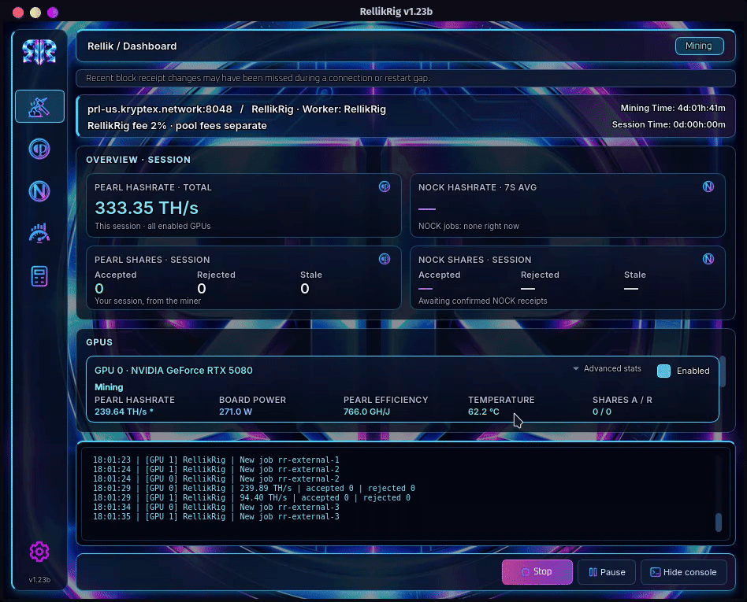

🚀🔥 **RellikRig v1.3 Beta for Linux**

⛏️ Multi-pool mining per GPU, multi-GPU detection, live Auto Tune, and performance benchmarks are now in the Linux beta.

⚡ Auto Tune compares Fastest, Balanced, and Efficient profiles across supported RTX 20, 30, 40, and 50 series GPUs.

📊 Benchmark profiles with live readings and saved performance history.

💻 Download the [Linux 1.3 beta](https://github.com/RellikRig/RellikRig-Pearl/releases/tag/v1.3-beta). The AppImage supports Linux x86-64, including Arch and Debian-based distributions. A Debian package is available for Debian-based systems.

🧪 Beta software can expose GPU driver instability. Save a working profile before tuning.

---

# RellikRig

**Pearl (PRL) GPU miner** for Windows and Linux, with an Apple Silicon preview for macOS and optional **NOCK merge mining** (beta).

Clean desktop GUI • Live statistics • Idle-aware mining • System tray controls  
**0% developer fee** when mining on the official Rellik pool

[Download v1.23b](https://github.com/RellikRig/RellikRig-Pearl/releases/tag/v1.23b-rc) · [Changelog](CHANGELOG.md) · [Pool Dashboard](https://pearl.rellik.dev)

---

### Follow for Updates

- **X / Twitter:** [@rellikdev](https://x.com/rellikdev)
- **TikTok:** [@rellik.dev](https://www.tiktok.com/@rellik.dev)
- **Reddit:** [u/RellikDev](https://www.reddit.com/u/RellikDev)
- **Email Support:** [rellikdev@gmail.com](mailto:rellikdev@gmail.com)

---

[Download the walkthrough (MP4)](https://github.com/RellikRig/RellikRig-Pearl/releases/download/v1.23b-rc/RR123b.mp4)

---

### What’s new in v1.23b

- **Per-GPU tuning:** Updated mining profiles tested on the RTX 2070, RTX 3070, and RTX 5080.
- **Cleaner multi-GPU dashboard:** Scroll through your GPU cards with the terminal open. Choose which cards mine and leave one free for gaming.
- **Easier setup:** Grouped settings and a first-run reminder to enter your own payout address.
- **Clearer Pearl and NOCK stats:** See which jobs each GPU is working on and which NOCK shares the pool confirmed. NOCK merge mining remains in beta.

### Download and quick start

| Platform | Download | How to run |
|---|---|---|
| Windows x64 | [Portable EXE](https://github.com/RellikRig/RellikRig-Pearl/releases/download/v1.23b-rc/RellikRig-Windows-1.23b-RC.exe) | Run the EXE. |
| Linux x86-64 (including Arch-based Garuda) | [AppImage](https://github.com/RellikRig/RellikRig-Pearl/releases/download/v1.23b-rc/RellikRig-1.23b-x86_64.AppImage) | Make it executable and open it. |
| Ubuntu amd64 | [DEB package](https://github.com/RellikRig/RellikRig-Pearl/releases/download/v1.23b-rc/rellikrig_1.23b_amd64.deb) | Install the package, then open RellikRig. |
| macOS (Apple Silicon) | [Earlier v1.23a RC1 preview](https://github.com/RellikRig/RellikRig-Pearl/releases/tag/v1.23a-rc1#assets) | No new macOS build in v1.23b. |

1. Download your package and verify it against the matching release’s checksums: [v1.23b SHA256SUMS](https://github.com/RellikRig/RellikRig-Pearl/releases/download/v1.23b-rc/SHA256SUMS) or [earlier release assets](https://github.com/RellikRig/RellikRig-Pearl/releases/tag/v1.23a-rc1#assets).
2. Open RellikRig and enter your own Pearl payout address.
3. Optionally enable NOCK merge mining and enter your NOCK payout address.
4. Select the GPUs you want to use and click **Start miner**.

**Default pool:** `stratum+ssl://pearl.rellik.dev:3333`

[Full v1.23b release notes](https://github.com/RellikRig/RellikRig-Pearl/releases/tag/v1.23b-rc) · [Older releases](https://github.com/RellikRig/RellikRig-Pearl/releases)

---

### Testing

- **Garuda Linux (Arch-based):** The v1.23b AppImage was tested on Garuda.
- **Ubuntu 24.04:** The AppImage and DEB passed startup checks in a container. Live Ubuntu hardware mining is not yet verified for v1.23b.
- **Windows:** The RTX 3070 and RTX 5080 workers started. The RTX 2070 passed offline proof and local submission checks; live Windows mining on the 2070 is not yet verified for this build.

<strong>Earlier NVIDIA benchmarks</strong>

| GPU | VRAM | Observed Pearl hashrate |
|---|---|---|
| NVIDIA H100 SXM | 80 GB | 221.98 TH/s |
| NVIDIA RTX PRO 4500 Blackwell | 32 GB | 154.96 TH/s |
| NVIDIA RTX A6000 | 48 GB | 89.13 TH/s |

Results vary with drivers, power limits, and cooling. These tests don’t establish support for every GPU combination or confirm NOCK payouts.

### Features

- Native RellikRig mining engine (NVIDIA on Windows/Linux)
- Live dashboard with hashrate, shares, GPU monitoring, and terminal
- Primary + backup pool failover with automatic return
- Idle-aware mining (automatically pauses while you're using the PC)
- System tray controls and optional start-on-launch
- Built-in mining calculator and benchmark history
- Optional **NOCK merge mining** (Beta)
- Persistent settings and mining totals outside the install folder

---

### What is Merge Mining?

Merge mining allows you to mine **two coins at the same time** with the same GPU hashrate, without needing extra hardware or significantly higher power draw.

In RellikRig this means:

- You mine **Pearl (PRL)** as the primary coin
- At the same time, the miner can also submit work for **NOCK**
- You earn potential rewards from both chains using the same GPU effort

Simply enable the feature in Settings and add your NOCK wallet address.

**Note:** NOCK merge mining is currently in **Beta**. Pearl mining continues even if NOCK work is temporarily unavailable. You may experience occasional pauses in the auxiliary work and incomplete pool-side statistics while the feature matures.

---

### Fees

| Engine                        | RellikRig Developer Fee     |
|------------------------------|-----------------------------|
| Native engine on Rellik Pool | **0%**                      |
| Native engine on other pools | **2%**                      |

Pool fees are separate. The official Rellik Pool currently charges **1%**.

---

### NOCK Merge Mining (Beta)

1. Go to **Settings**
2. Enable merged mining (Pearl + NOCK)
3. Enter your own **NOCK** receiving address
4. Save settings and restart the miner

Pearl mining continues running even if NOCK work pauses. Local shared GPU work is shown in MAC/s or TMAC/s.

---

### Important Notes

- **Set your own receiving addresses** before you start mining. If an older build has a prefilled wallet, replace it with yours.
- Cryptocurrency miners are frequently flagged by antivirus software. Only download from this official repository and always verify checksums.
- Windows and Linux builds require a recent NVIDIA driver.
- This is closed-source software.

---

### Support & Contact

- **Email:** [rellikdev@gmail.com](mailto:rellikdev@gmail.com)
- **X:** [@rellikdev](https://x.com/rellikdev)
- **TikTok:** [@rellik.dev](https://www.tiktok.com/@rellik.dev)
- **Reddit:** [u/RellikDev](https://www.reddit.com/u/RellikDev)
- Additional support details: [SUPPORT.md](SUPPORT.md)

---

### Licensing

See [Licensing](LICENSING.md).
