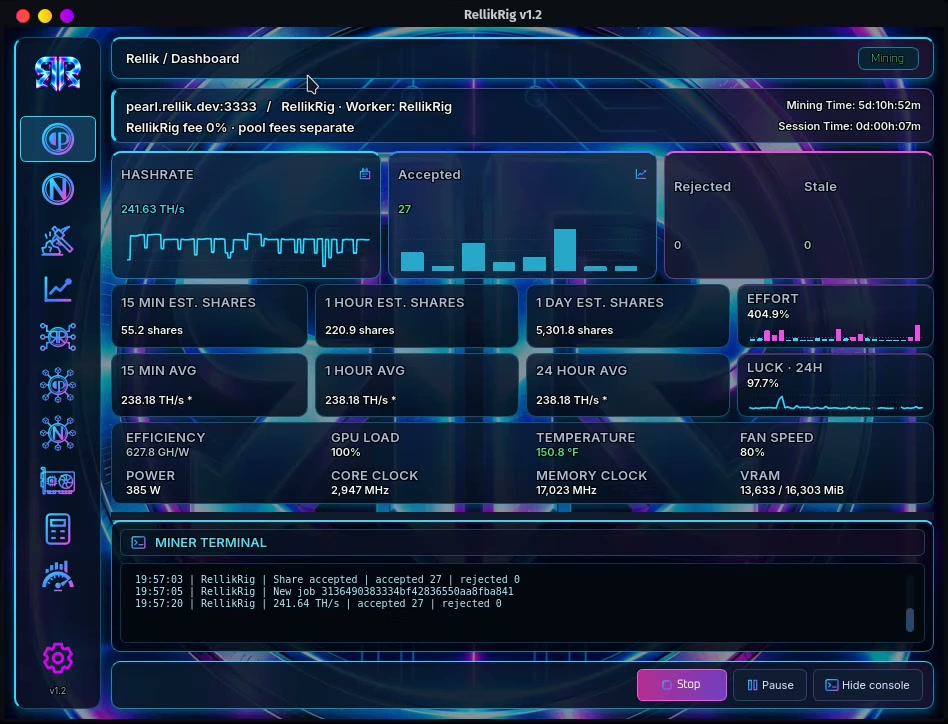
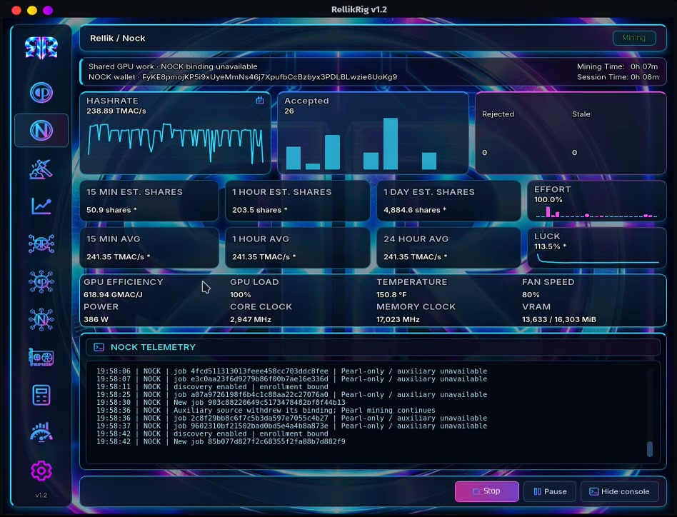
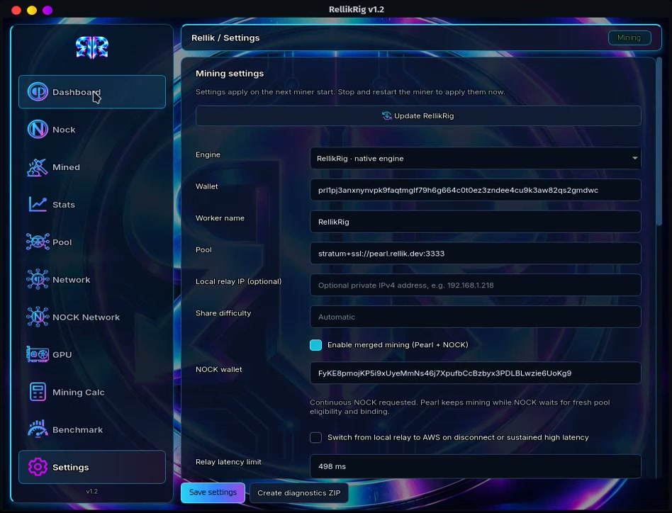
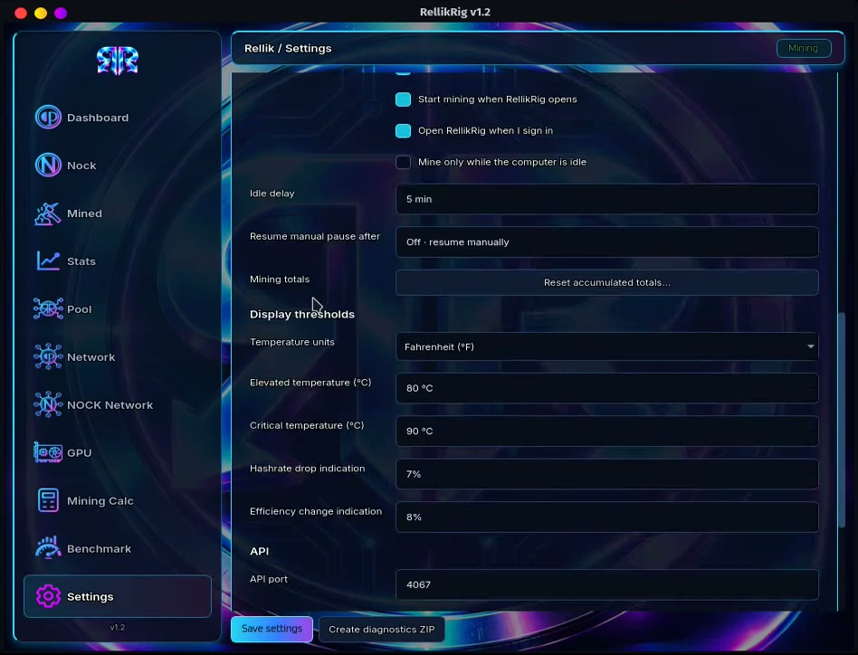
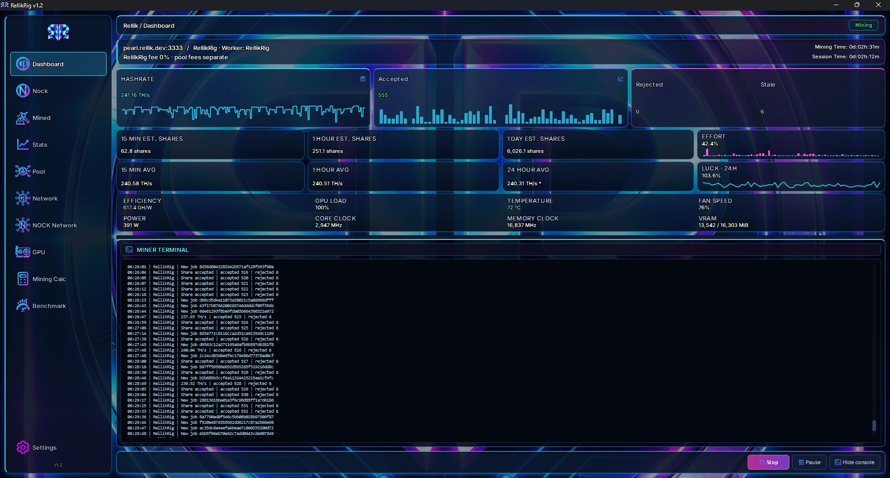
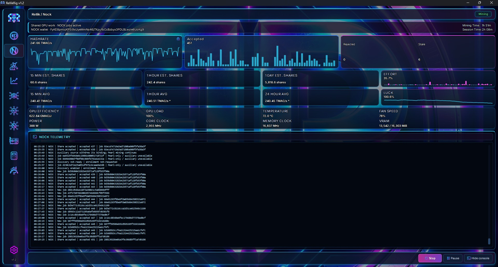
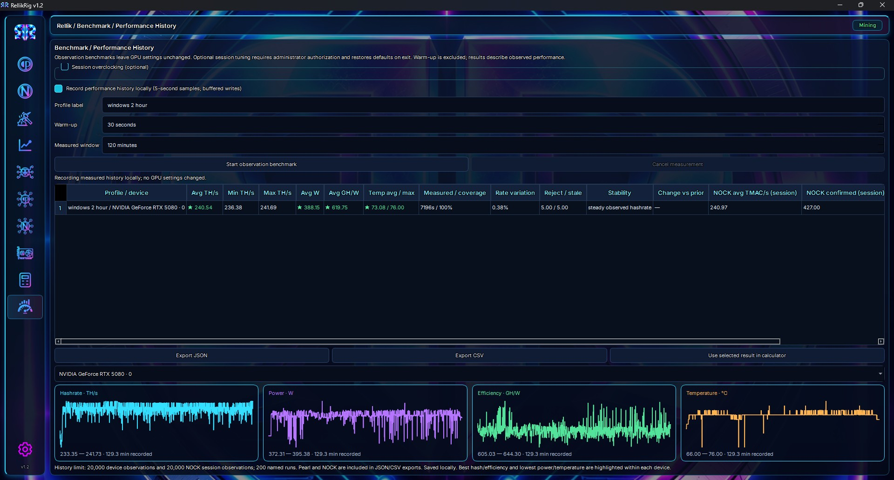
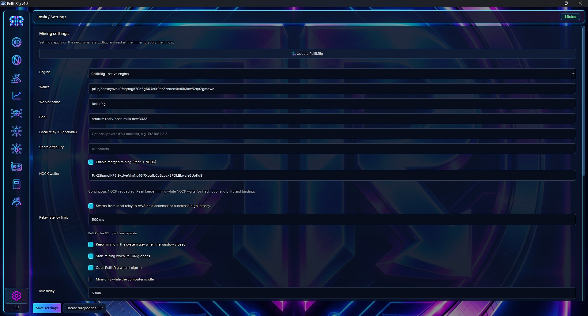
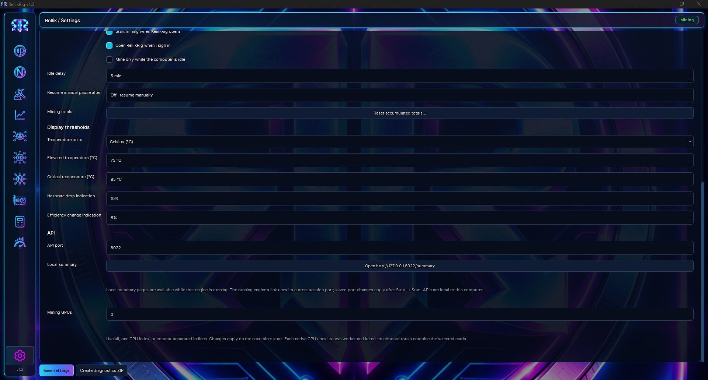

# RellikRig v1.2 preview gallery

[Full Linux demo](RellikRig-Demo-v12.mp4) · [Main README](../../README.md)

These owner-provided views show the upcoming Windows/Linux GUI. NOCK merge mining is Beta. Published v1.10 downloads and earlier Mac screenshots remain separate.

## Linux

## Windows

Screenshots and demo illustrate observed behavior, not guaranteed mining performance or continuous NOCK readiness. Public receiving addresses visible in these owner captures belong to the publisher; use your own addresses when mining for yourself.
